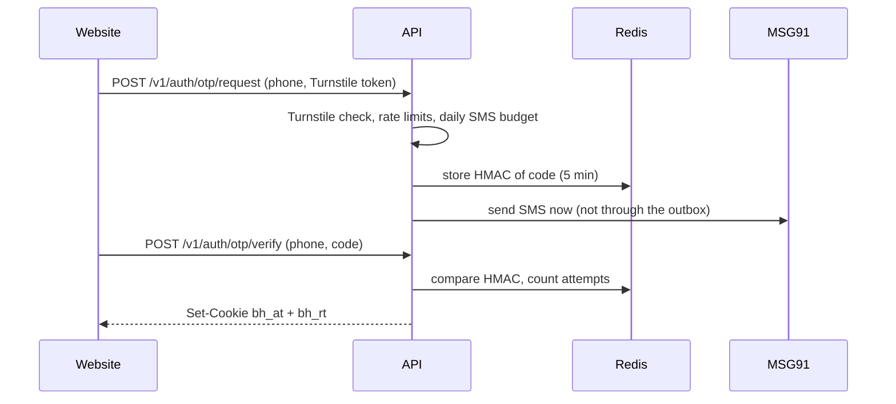

# Auth and sessions

There are two **realms** with separate cookies, signing keys and routes. A customer token can never be used as a staff token ([ADR 0019](../decisions.md#0019)).

| | Customers | Staff |
| --- | --- | --- |
| Sign in with | Mobile OTP only | Google account on an allowlist |
| Module | `src/modules/auth` | `src/modules/staff` |
| Access cookie | `bh_at`, 15 minutes | `bh_staff_at`, 15 minutes |
| Refresh cookie | `bh_rt`, 30 days, path `/v1/auth` | `bh_staff_rt`, path `/v1/admin/auth` |
| Signing key | `CUSTOMER_SESSION_SECRET` (HS256, with `kid`) | `STAFF_SESSION_SECRET` (HS256) |

Cookies are `HttpOnly`, `SameSite=Lax`, `Secure` in production, and scoped to `COOKIE_DOMAIN` (for example `.bachelorhouse.in`) so web and admin subdomains share them. A mobile app sends `Authorization: Bearer` and `X-Client-Type: mobile` instead.

## Customer sign-in

- Codes are **6 digits** (`otp.length`) and live **5 minutes**. Only an HMAC of the code and of the phone number is stored (`OTP_HMAC_SECRET`); the code itself is never logged.
- Limits come from settings: resend after 30 seconds, 5 per phone per hour, 10 per day, 20 per IP per hour, and a global daily SMS budget (`otp.daily_global_budget`). Past the budget, OTP requests get `503`.
- The SMS is sent straight through the SMS adapter, so a provider failure becomes a `503` in the same request.
- A first sign-in creates the user with a pending profile. Only the profile routes are open until it's completed (`requireCustomer({ allowPendingProfile: true })`).
- Changing the phone number is a separate OTP flow (`auth.phone-change.ts`).

## Refresh and reuse detection

Each sign-in starts a **family** of refresh tokens, stored hashed in `sessions`. `POST /v1/auth/refresh` rotates the token:

- Presenting a token that was already rotated **revokes the whole family** (`REFRESH_TOKEN_REUSED`) and is audited.
- Two refreshes racing within 30 seconds get `409 REFRESH_IN_PROGRESS` instead, so a double click doesn't sign anyone out.
- A suspended account's family is revoked on its next refresh.
- Users can list and revoke their own sessions (`/v1/me/sessions`).

**Rotating the signing key:** move the current value to `CUSTOMER_SESSION_SECRET_PREVIOUS`, set a new `CUSTOMER_SESSION_SECRET`, deploy, and remove the previous key after 15 minutes. Tokens carry a `kid`, so nobody is signed out.

## Staff sign-in

1. The admin portal gets a Google ID token and posts it to the staff sign-in route.
2. The API verifies it against `GOOGLE_CLIENT_ID`, then checks the email is in `STAFF_ALLOWED_EMAILS` or on `STAFF_ALLOWED_DOMAIN`, **and** has a `staff_users` row. The seed creates one for `SUPER_ADMIN_EMAIL`.
3. Staff sessions are limited to 8 hours.

Every `/v1/admin` route checks a **permission**. Roles map to permissions in `src/modules/staff/staff.permissions.ts`: for example, `listings.moderate` is held by super admin, admin and moderator; `settings.manage` and `staff.manage` by super admin only. See [Staff roles](/product/platform/staff-roles) for the full table.

## Captcha

OTP requests and public forms check a Cloudflare Turnstile token with `TURNSTILE_SECRET_KEY`. With the key unset, the check **fails closed**: every request gets `CAPTCHA_FAILED`.
