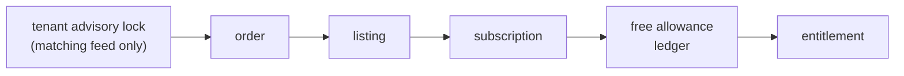

# Concurrency and time

Money depends on limits that a race must never over-grant: Free listings, credits, agent slots, coupon uses. The backend relies on Postgres for this, not on application checks.

## Lock order

A transaction that locks several rows takes them **in this order**, or in the same relative order when it needs fewer ([ADR 0015](../decisions.md#0015)):

Two flows that follow the same order can't deadlock. Review has to check it: there's no automated guard.

## Patterns

| Pattern | Where |
| --- | --- |
| **`SELECT … FOR UPDATE`** on the row you spend from, then update | Ledger reservations, entitlements, coupons, subscriptions, the order during fulfilment |
| **CHECK constraints** as the last line | `used + reserved ≤ granted` (entitlements), `slots_used ≤ slot_limit` (subscriptions), order amount identities |
| **Unique partial indexes** as a backstop | One open order per listing, city or account; one usage row per subject |
| **Advisory locks** | Checkout lock per target; `exclusive()` for housekeeping jobs |
| **Optimistic locking** | `draft_version` with `If-Match` on wizard steps |
| **Idempotency keys** | Order creation and other side-effect routes ([Request pipeline](./request-pipeline.md#idempotency)) |

If two requests race past the application check, one fails on the constraint instead of over-granting. The nightly slot recount is meant to alert on drift and never auto-correct; it has no handler yet.

## Money and time \{#money-and-time\}

From [ADR 0016](../decisions.md#0016), with helpers in `src/lib/money.ts` and `src/lib/time.ts`:

| Kind | Column | In code |
| --- | --- | --- |
| Rents, deposits | `integer`, whole rupees | `Rupees` (safe integer) |
| Prices, tax, payments, invoices | `bigint`, paise | `Paise` (bigint). node-postgres returns `bigint` as a string: always go through `toPaise`. |
| Timestamps | `timestamptz`, UTC | Shown in IST |
| Business dates (available from, validity end dates) | `date`, computed in Asia/Kolkata | IST is a fixed +05:30 with no DST, so no timezone database is needed |

- **Never floating point** for money. Conversions reject fractions.
- **Validity is exact hours:** `ends_at = starts_at + days × 24 h`. A 30-day plan verified at 23:50 IST ends 720 hours later, also at 23:50 IST.
- **Windows are `[starts_at, ends_at)`:** start inclusive, end exclusive.
- **Read time decides** ([ADR 0014](../decisions.md#0014)): every query that grants a benefit checks its end against `now()`. Expiry jobs only tidy statuses, so a late job can't extend anything.
