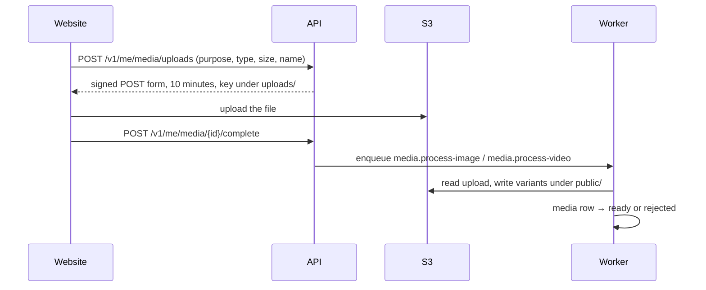

# Media and KYC

## Buckets

| Bucket | Env var | Access | Holds |
| --- | --- | --- | --- |
| Media | `S3_BUCKET_MEDIA` (`bh-media`) | Public through CloudFront (`CLOUDFRONT_BASE_URL`), only under `public/` | Listing photos and video, agent photos, résumés |
| KYC | `S3_BUCKET_KYC` (`bh-kyc`) | Private, SSE-KMS (`KMS_KEY_ID_KYC`) | Identity and ownership documents |
| Invoices | `S3_BUCKET_INVOICES` (`bh-invoices`) | Private | Invoice PDFs (not used yet) |

Locally all three are MinIO buckets you create once ([Local setup](../getting-started/local-setup.md#one-time-setup)). `src/lib/storage/storage.ts` wraps S3 and uses path-style addressing whenever `S3_ENDPOINT` is set.

## Upload flow

The API never carries upload bytes ([ADR 0020](../decisions.md#0020)).

| Purpose | Types | Max size | Bucket |
| --- | --- | --- | --- |
| `listing_photo` | PNG, JPEG, WebP, GIF | 4 MB | media |
| `listing_video` | MP4, MOV, MPEG, AVI, WMV, FLV, 3GP, WebM | 100 MB | media |
| `agent_photo` | JPEG, PNG, WebP | 4 MB | media |
| `kyc_document` | JPEG, PNG, PDF | 5 MB | kyc |
| `resume` | PDF | 5 MB | media |

The declared type must match the file name's extension. The signed form limits type and size, so S3 itself refuses anything else.

## Processing

**Images** (`media.process-image`, queue `media`):

- Checks the file signature (magic bytes), not the declared type. Refuses images over 50 megapixels.
- Strips metadata and re-encodes. SVG is never accepted.
- Writes **WebP and AVIF** at **320, 800 and 1600 px**. For listing photos the 1600 px version carries the logo watermark and replaces the plain one, so no public URL serves the large photo without it. The mark is a stand-in until the brand logo arrives (`media.watermark.ts`).
- KYC files get only the content check and stay untouched in the private bucket.
- Computes a perceptual hash (used by duplicate checks at submit) and a blur placeholder.

**Video** (`media.process-video`, queue `media-video`, concurrency 1): ffmpeg (installed in the image) probes the file, transcodes to MP4 H.264 at most 1080p with a 20-minute timeout, and extracts a poster frame. Input is limited to local files (`-protocol_whitelist file`).

The listing shows only `ready` media. `media.sweeper` (every 5 minutes) re-queues media stuck in `processing`; `media.orphan-cleanup` (03:00 IST) removes uploads never attached to anything. An S3 lifecycle rule should delete `uploads/` after 24 hours; it's infrastructure, not code.

## KYC

PG listings need the operator's KYC ([ADR 0022](../decisions.md#0022), [PG KYC](/product/listing/pg-kyc)):

- KYC belongs to the **operator**, not the listing: `kyc_submissions` and `kyc_documents`.
- Files go to the private bucket. Staff view them through **60-second** presigned links, and every view is written to `audit_logs` with who, when and why.
- After a decision, only the document type, the last 4 characters of the number and the decision are kept long-term. `kyc.purge-files` (daily) deletes the files **180 days** after the decision. Aadhaar numbers are never stored in full.
- Résumés from job applications use the same pattern: 60-second view links.
