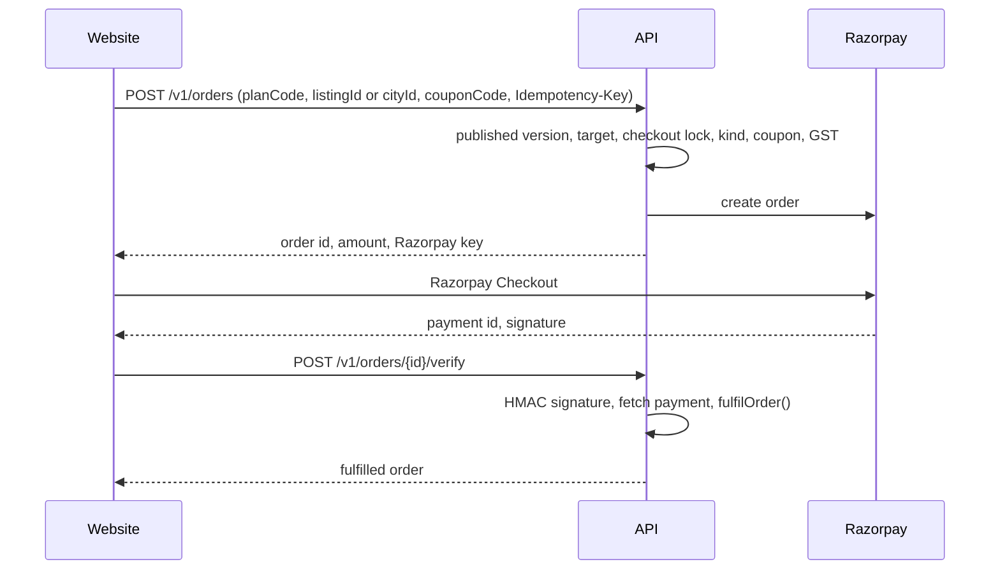

# Money and billing

Three modules: `plans` (plans, versions, coupons), `billing` (orders, payments, subscriptions, billing profiles) and `entitlements` (countable quotas and the Free ledger). Users' side: [Plans and pricing](/product/money/plans-and-pricing), [Checkout and GST](/product/money/checkout-and-gst).

## Stores

| Store | Holds | Rule |
| --- | --- | --- |
| `plans`, `plan_versions` | A plan's price and typed benefits from a date | A published version never changes; a change is a new version. One published version per plan at a time. |
| `orders` | One checkout: amounts, GST split, plan snapshot | `taxable = base − discount`, `total = taxable + cgst + sgst + igst` are CHECKs. One open order per listing, city or account (unique partial indexes). |
| `payments` | Captured Razorpay payments | Amount comes from Razorpay, never the client |
| `subscriptions` | A running or scheduled plan term on a listing, agent city or account | `slots_used ≤ slot_limit` |
| `entitlements`, `entitlement_usages` | Countable quotas: reveals, matching credits, boosts, shoots, staff grants | `used + reserved ≤ granted`; one usage row per subject, so a retry never spends twice |
| `free_allowance_ledger` | Tenant free credits and the owner/PG Free listing, keyed by phone HMAC | `available → reserved → consumed`; survives account deletion |
| `coupons`, `coupon_redemptions` | Discount codes and their use | Capped at 40% |

([ADR 0007](../decisions.md#0007), [0014](../decisions.md#0014))

## Checkout

`POST /v1/orders` (`billing.orders.ts`), in one transaction:

1. Find the plan for the buyer's account type and its version published now.
2. Resolve the target: a listing (owner, PG), a city (agent) or none (tenant package).
3. **Checkout lock:** one open order per target. The caller's own open order comes back as is (`200`).
4. **Kind:** `new`, `renewal`, `upgrade` or `downgrade`. Same tier while running is refused (`PLAN_ALREADY_ACTIVE`). An agent downgrade needs live listings to fit the lower slot limit.
5. **Coupon:** validated and reserved under the coupon row lock.
6. **Amounts** from the version and the billing profile's state. The browser never sends an amount.
7. Insert the order with its plan snapshot, reserve the redemption, create the Razorpay order. A provider failure rolls everything back.

Unpaid orders expire after **30 minutes** (`billing.expire-orders`, every 5 minutes). Without Razorpay keys, `POST /v1/orders` answers `503`.

## GST

`splitGst` in `src/lib/gst.ts` does the maths ([ADR 0011](../decisions.md#0011)):

- Prices are shown before 18% GST. A coupon comes off **before** GST.
- Place of supply is the billing profile's state (validated against the GSTIN's first two digits). Maharashtra buyers pay CGST 9% + SGST 9%; others IGST 18%.
- Total tax is rounded half up once on the taxable amount. Intra-state, CGST takes the odd paisa so CGST + SGST equals the total exactly. This rounding rule still needs finance's confirmation.
- Example: ₹1,499 → taxable 149,900 paise, tax 26,982 paise.

## Fulfilment

`fulfilOrder()` (`billing.fulfil.ts`) is the single path for both the checkout callback and, later, the webhook. It runs under a row lock on the order, so a second call waits and then sees `fulfilled`.

- Writes the `payments` row, creates the `subscriptions` term and its `entitlements`.
- **Upgrade** or new tenant package: earlier terms end now and their unused entitlements lapse. **Downgrade**: starts when the current term ends.
- **Agent plan starting now:** the city's live listings move onto it, up to the slot limit.
- Money for an order already closed is kept for finance, not turned into a plan. An amount mismatch is flagged, never fulfilled.
- After commit, `billing.zoho-sync` is queued for the invoice.

## Not built

| Piece | State |
| --- | --- |
| Razorpay webhook | No route. `billing.process-webhook` has no handler. A user who closes the tab after paying stays unfulfilled until they return. |
| Reconciliation | `billing.reconcile` (every 15 minutes) has no handler |
| Invoices | `billing.zoho-sync` has no handler; no Zoho client exists |
| Refunds | `billing.auto-refunds` is queued when a listing with a plan is rejected before going live, but has no handler |
| Subscription lifecycle, reminders, slot recount | Jobs exist with no handler |
| Subscriptions → listings | Listing submit doesn't read subscriptions ([Listings](./listings.md#publish-rights)) |

The [jobs reference](../reference/jobs.md) is kept up to date by the sync.
