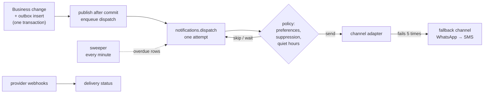

# Notifications

Code never calls an SMS, email or WhatsApp provider directly (the sign-in OTP is the one exception). It writes a notification row, and the worker delivers it ([ADR 0021](../decisions.md#0021)). Users' side: [Notifications](/product/accounts/notifications).

## Writing a notification

1. In the transaction of the business change, call the outbox insert (`notifications.outbox.ts`) with the event code, recipient, data and an optional `dedupeKey`. A used `dedupeKey` returns nothing, so the same event never notifies twice.
2. After commit, `publishNotifications` enqueues the dispatch job. If that fails it's logged and swallowed: the row is durable and the sweeper re-queues it within a minute.

## Delivering

`notifications.dispatch` makes **one attempt** for one row:

- A finished, missing or not-yet-due row is skipped, so a replayed job sends nothing twice.
- The row is claimed as `sending` for 5 minutes; after that the sweeper may give it to another worker.
- The template is looked up by event, channel and locale (falling back to the default locale) and rendered. Provider template ids (DLT for SMS, template names for WhatsApp) are stored on the template.
- Up to **5 attempts per channel**, backing off 30 s, 1 min, 2 min, 4 min. Then the row fails and, if the channel has one, the same message is queued on the **fallback**: WhatsApp falls back to SMS. Email, SMS and in-app have none.

## Policy

Checked on every attempt (`notifications.policy.ts`):

- The first segment of the event code picks the group (`payment.receipt` → `payment`). **OTP and payment receipts can't be switched off.** Marketing starts off and needs an opt-in. An unknown prefix lands in `updates`, which users can switch off, so a new event is never essential by accident.
- Suppressed addresses are skipped. An `unsubscribed` entry covers marketing only; bounces, complaints and DND cover everything.
- **Quiet hours:** marketing between 21:00 and 09:00 IST waits until 09:00.
- Non-essential email gets a signed unsubscribe link and `List-Unsubscribe` headers (`UNSUBSCRIBE_HMAC_SECRET`, `PUBLIC_API_URL`).

## Channels

| Channel | Provider | Templates seeded |
| --- | --- | --- |
| `sms` | MSG91 | OTP only (sent directly) |
| `email` | Brevo | Yes |
| `whatsapp` | WhatsApp Cloud API | No |
| `push` | Firebase Cloud Messaging (optional) | No |
| `in_app` | Stored rows, read by `/v1/me/notifications` | Yes |

Outside staging and production, every channel uses the **log adapter**: it logs the notification id, channel and masked recipient, and sends nothing.

## Provider webhooks

`/v1/webhooks/msg91`, `/v1/webhooks/brevo` and `/v1/webhooks/whatsapp` (plus the WhatsApp `GET` verification) update delivery status. Each checks a shared token or signature over the raw body, optionally a source IP list (`*_WEBHOOK_IPS`), and records each event once in `webhook_events`. Bounces and complaints feed the suppression list.
