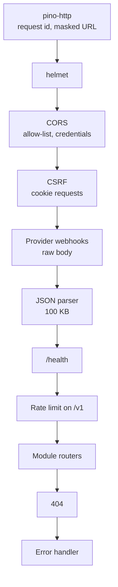

# Request pipeline

`createApp()` in `src/app.ts` builds the Express 5 app. Order matters, so here it is as mounted:



| Step | What it does |
| --- | --- |
| **Request id** | `pino-http` reads `X-Request-Id` (or makes one), echoes it on the response and on every log line. Query strings in logged URLs are masked. |
| **Helmet** | Security headers. `x-powered-by` is off. |
| **CORS** | Only origins in `CORS_ORIGINS`, with credentials. Allowed headers include `Idempotency-Key`, `X-Requested-With`, `X-Client-Type`. Exposed: `X-Request-Id`, `Retry-After`, `Location`. |
| **CSRF** | A `POST`, `PUT`, `PATCH` or `DELETE` that carries a session cookie must send `X-Requested-With: bh-web` (`bh-admin` on `/v1/admin`) **and** an allowed `Origin`, else `403 CSRF_REJECTED`. Mobile clients (`X-Client-Type: mobile`) use a bearer token and are exempt. |
| **Webhooks** | `/v1/webhooks/msg91`, `/brevo` and `/whatsapp` read the raw body (signatures cover the bytes), so they come before the JSON parser. There is no Razorpay webhook route yet. |
| **Body limit** | JSON only, 100 KB; larger bodies get `413` with code `VALIDATION_FAILED`. |
| **Health** | `GET /health/live` (process up) and `GET /health/ready` (database reachable). Not rate limited. |
| **Rate limit** | `RATE_LIMIT_MAX` requests per `RATE_LIMIT_WINDOW_MS` per IP across `/v1` (100 per minute by default). Sensitive routes add their own limits from settings (OTP, forms). |
| **Contract** | `GET /v1/openapi.json` is served outside production. |

## Validation

Every route is declared with `defineRoute` ([Codebase conventions](../getting-started/codebase-conventions.md#adding-an-endpoint)). Its Zod schemas validate `body`, `query` and `params` before the handler runs, and the same schemas generate the OpenAPI document, so the contract can't drift from the code ([ADR 0005](../decisions.md#0005)). Unknown fields are rejected.

## Response shapes

```json
// item
{ "data": { … } }

// list
{ "data": [ … ], "meta": { "page": 1, "pageSize": 20, "total": 134 } }

// error
{ "error": { "code": "PLAN_REQUIRED", "message": "…", "requestId": "…", "details": { … } } }
```

`201` responses for created resources carry a `Location` header. Every response carries `X-Request-Id`.

## Errors

Services throw `DomainError('<CODE>')`. The code's HTTP status and safe default message come from `ERROR_CATALOGUE` in `src/lib/errors.ts`. Only `src/middlewares/error-handler.ts` turns errors into responses. Unknown errors become `500 INTERNAL_ERROR`, are logged with the stack and sent to Sentry; internals never reach the client.

A `VALIDATION_FAILED` response lists each failed field in `details` as `{ path, code, message }`. Each route's contract lists the codes it raises on purpose; see the [API reference](/engineering/reference/api) and [Error codes](../reference/error-codes.md).

## Idempotency

Routes with `idempotent: 'required'` (orders, for example) reject a request without `Idempotency-Key`. The `idempotency` module stores the key against the method, full URL and body (keys sorted), and the caller's id:

| Situation | Answer |
| --- | --- |
| Same key, same request, first call succeeded | The stored 2xx response, replayed for **24 hours** |
| Same key, different request | `422` |
| Same key while the first call is still running | `409` |
| First call ended in an error | The key is released, so the client can retry |

`retention.cleanup` purges old keys.

## Optimistic locking

Writes that two tabs could race take an `If-Match` header with the version the client last saw. Saving a wizard step with an older `draft_version` returns `409` ([Listings](./listings.md#drafts)).

## Access levels

| `auth` | Needs | Cookie |
| --- | --- | --- |
| `public` | Nothing | |
| `user` | A customer session (cookie or bearer) | `bh_at` |
| `staff` | A staff session, plus `requirePermission(...)` | `bh_staff_at` |

See [Auth and sessions](./auth-and-sessions.md).
