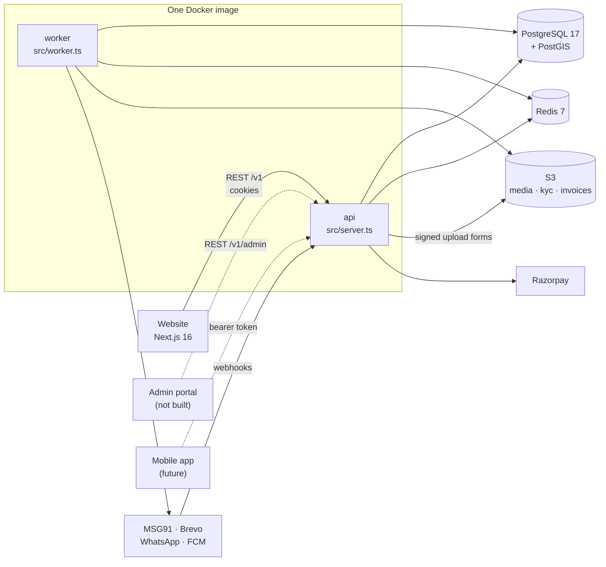

# Architecture

BachelorHouse is a **modular monolith**: one TypeScript codebase, one Docker image, started as two processes. The website is a separate Next.js app that will call the API; today it doesn't call it yet ([The website](../website/client.md)).

## The two processes

| Process | Entry | Does | Runs as |
| --- | --- | --- | --- |
| `api` | `src/server.ts` → `createApp()` in `src/app.ts` | Every HTTP route: public, customer, staff (`/v1/admin`) and provider webhooks | `npm start` (`node dist/server.js`) |
| `worker` | `src/worker.ts` | BullMQ consumers and repeatable schedules: notifications, media processing, expiry, retention | `npm run worker` (`node dist/worker.js`) |

Both load the same config (`src/config/env.ts`), database pool (`src/db/client.ts`) and modules. There is no separate cron server: the worker upserts its schedules on every start, so restarts never duplicate them ([ADR 0004](../decisions.md#0004)).

**The database row is the truth; a job is only a trigger.** A job loads its row, checks the current state and does nothing if the work is done. Sweepers re-queue rows stuck in an intermediate state. So a lost or repeated job never loses or repeats work. See [Background jobs](../backend/background-jobs.md).

## Dependencies

| Dependency | Used for | Locally |
| --- | --- | --- |
| PostgreSQL 17 + PostGIS | All data. Geometry for places, GiST and exclusion constraints, row locks | Docker, port 5433 |
| Redis 7 | BullMQ queues, OTP codes and rate limits, settings cache | Docker, port 6379 |
| S3 (3 buckets) | `media` (public via CloudFront), `kyc` (private, KMS), `invoices` (private) | MinIO, ports 9000/9001 |
| MSG91 | Sign-in OTP and SMS | Logged, not sent |
| Brevo | Email | Logged, not sent (Mailpit runs but isn't wired) |
| WhatsApp Cloud API | WhatsApp messages | Logged, not sent |
| Firebase Cloud Messaging | App push (optional) | Off |
| Razorpay | One-time payments | Test keys, or `POST /v1/orders` answers 503 |
| Cloudflare Turnstile | Captcha on OTP and public forms | Unset: captcha fails closed |
| Google sign-in | Staff sign-in | Unset: staff sign-in fails closed |
| Sentry | Errors from api and worker | Off |
| Zoho Books | GST invoices | Not built (`billing.zoho-sync` has no handler) |

## Modules

Code is organised by feature under `src/modules/<module>`. A module exposes its public API from `index.ts`; other modules import only that ([Codebase conventions](./codebase-conventions.md)).

| Area | Modules |
| --- | --- |
| Accounts | `auth` (OTP sign-in, sessions, phone change), `users` (profile, consents, email verification), `privacy` (export and erasure) |
| Listings | `listings` (drafts, submit, lifecycle, PG room alerts), `media` (uploads and processing), `kyc`, `moderation` (review queue), `disputes` (ownership disputes), `ranking` (quality score) |
| Money | `plans` (plans, versions, coupons), `billing` (orders, payments, subscriptions, billing profiles), `entitlements` (Free ledger, quotas, staff grants) |
| Content and places | `catalog` (amenities), `cms` (pages, articles, FAQs, banners, careers), `geo` (cities, localities, societies, landmarks), `forms` (contact, feedback, advertise, newsletter, job applications) |
| Platform | `staff` (Google sign-in, roles), `settings`, `audit`, `notifications`, `idempotency`, `housekeeping` (retention, partitions), `health`, `openapi` |

## What isn't built

The design documents describe more than exists. These modules and services have **no code yet**, though some have tables, settings or job names reserved for them:

- **Search and listing pages for tenants:** no search, listing detail or feed endpoints ([ADR 0009](../decisions.md#0009), [0012](../decisions.md#0012)).
- **Enquiries, contact gate and chat** ([ADR 0008](../decisions.md#0008)).
- **Subscriptions wiring to listings:** `publishRights` isn't passed to `createApp`, so listing submit uses `noPublishRights` and only an owner's Free listing can go live. See [Listings](../backend/listings.md#publish-rights).
- **Agent profiles**, boosts, matching, shoots, reviews, ranking rotation and analytics.
- **Razorpay webhooks and reconciliation, refunds, Zoho invoices.**
- **Hosting:** there is no deploy pipeline yet ([CI/CD](../operations/ci-cd.md)).

The [jobs reference](../reference/jobs.md) shows which background jobs have a handler.
