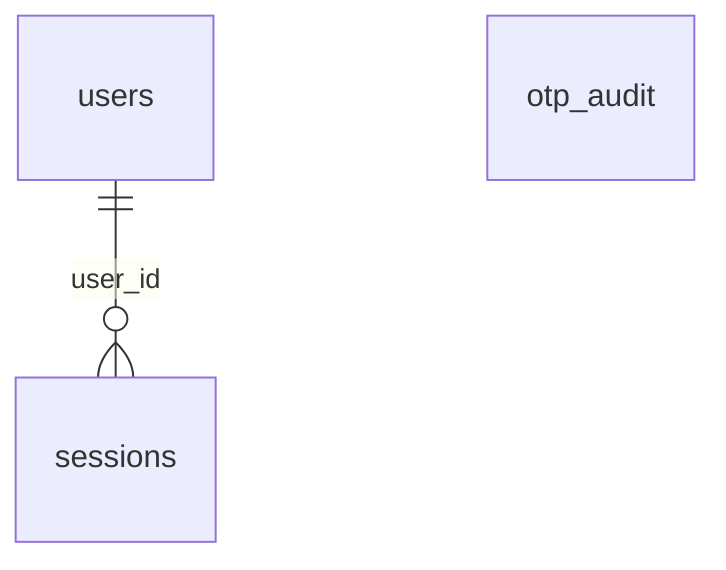

# Sign-in and sessions

:::info[Generated page]

Generated by `npm run sync` from **bachelor-house-backend** `chore/scaffold-from-reference`. Don't edit it by hand: the next sync overwrites it.
:::

2 tables owned by `src/modules/auth`: [`otp_audit`](#otp-audit), [`sessions`](#sessions).

## `otp_audit` \{#otp-audit\}

Doc 03 section 4: the audit trail for limits, fraud review and SMS cost. OTP values live only in Redis. Holds the keyed hash of the number, never the number. Retained 90 days.

Defined in [`src/modules/auth/auth.table.ts`](https://github.com/oplifyterminal/bachelor-house-backend/blob/chore/scaffold-from-reference/src/modules/auth/auth.table.ts).

| Column | Type | Null | Default | Notes |
| --- | --- | --- | --- | --- |
| `id` | `uuid` |  | `gen_random_uuid()` | PK |
| `phone_hash` | `text` |  |  |  |
| `purpose` | `text` |  |  |  |
| `ip` | `inet` | yes |  |  |
| `provider_message_id` | `text` | yes |  |  |
| `status` | `text` |  |  |  |
| `attempts` | `smallint` |  | `0` |  |
| `created_at` | `timestamp with time zone` |  | `now()` |  |

Constraints and indexes

- **Index** `otp_audit_phone_created_idx` (btree): `phone_hash, created_at`
- **Index** `otp_audit_ip_created_idx` (btree): `ip, created_at`

## `sessions` \{#sessions\}

Doc 03 section 4 (sessions). One row per refresh token; the rows of one sign-in share `familyId`, and each rotation inserts a row and points the old one at it through `replacedById`. Only the SHA-256 of a token is stored. `expiresAt` is the 30-day life of that token, renewed on rotation.

Defined in [`src/modules/auth/auth.table.ts`](https://github.com/oplifyterminal/bachelor-house-backend/blob/chore/scaffold-from-reference/src/modules/auth/auth.table.ts).

| Column | Type | Null | Default | Notes |
| --- | --- | --- | --- | --- |
| `id` | `uuid` |  | `gen_random_uuid()` | PK |
| `user_id` | `uuid` |  |  | → `users.id` (on delete cascade) |
| `family_id` | `uuid` |  |  |  |
| `refresh_token_hash` | `text` |  |  |  |
| `replaced_by_id` | `uuid` | yes |  |  |
| `user_agent` | `text` | yes |  |  |
| `ip` | `inet` | yes |  |  |
| `last_used_at` | `timestamp with time zone` |  | `now()` |  |
| `expires_at` | `timestamp with time zone` |  |  |  |
| `revoked_at` | `timestamp with time zone` | yes |  |  |
| `revoked_reason` | `text` | yes |  |  |
| `created_at` | `timestamp with time zone` |  | `now()` |  |

Constraints and indexes

- **Unique** `sessions_refreshTokenHash_unique`: (`refresh_token_hash`)
- **Index** `sessions_user_id_index` (btree): `user_id` where `sessions.revoked_at IS NULL`
- **Index** `sessions_family_id_index` (btree): `family_id`

