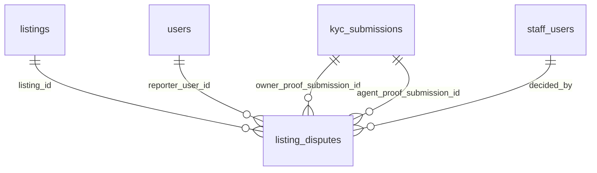

# Ownership disputes

:::info[Generated page]

Generated by `npm run sync` from **bachelor-house-backend** `chore/scaffold-from-reference`. Don't edit it by hand: the next sync overwrites it.
:::

1 table owned by `src/modules/disputes`: [`listing_disputes`](#listing-disputes).

## `listing_disputes` \{#listing-disputes\}

Doc 03 section 6, `listing_disputes` (BR-AGT-21). `reason` and `agentNote` carry the S11 and L21 free text.

Defined in [`src/modules/disputes/disputes.table.ts`](https://github.com/oplifyterminal/bachelor-house-backend/blob/chore/scaffold-from-reference/src/modules/disputes/disputes.table.ts).

| Column | Type | Null | Default | Notes |
| --- | --- | --- | --- | --- |
| `id` | `uuid` |  | `gen_random_uuid()` | PK |
| `listing_id` | `uuid` |  |  | → `listings.id` (on delete restrict) |
| `reporter_user_id` | `uuid` |  |  | → `users.id` (on delete restrict) |
| `owner_proof_submission_id` | `uuid` |  |  | → `kyc_submissions.id` (on delete restrict) |
| `status` | `dispute_status` |  | `'awaiting_proof'` |  |
| `reason` | `text` |  |  |  |
| `hidden_at` | `timestamp with time zone` |  |  |  |
| `proof_due_at` | `timestamp with time zone` |  |  |  |
| `agent_proof_submission_id` | `uuid` | yes |  | → `kyc_submissions.id` (on delete restrict) |
| `agent_note` | `text` | yes |  |  |
| `decided_by` | `uuid` | yes |  | → `staff_users.id` (on delete set null) |
| `decided_at` | `timestamp with time zone` | yes |  |  |
| `decision_note` | `text` | yes |  |  |
| `created_at` | `timestamp with time zone` |  | `now()` |  |
| `updated_at` | `timestamp with time zone` |  | `now()` |  |

Constraints and indexes

- **Unique index** `listing_disputes_one_open_idx` (btree): `listing_id` where `listing_disputes.status IN ('open','awaiting_proof','under_review')`
- **Index** `listing_disputes_reporter_status_idx` (btree): `reporter_user_id, status`
- **Index** `listing_disputes_due_idx` (btree): `proof_due_at` where `listing_disputes.status = 'awaiting_proof'`

