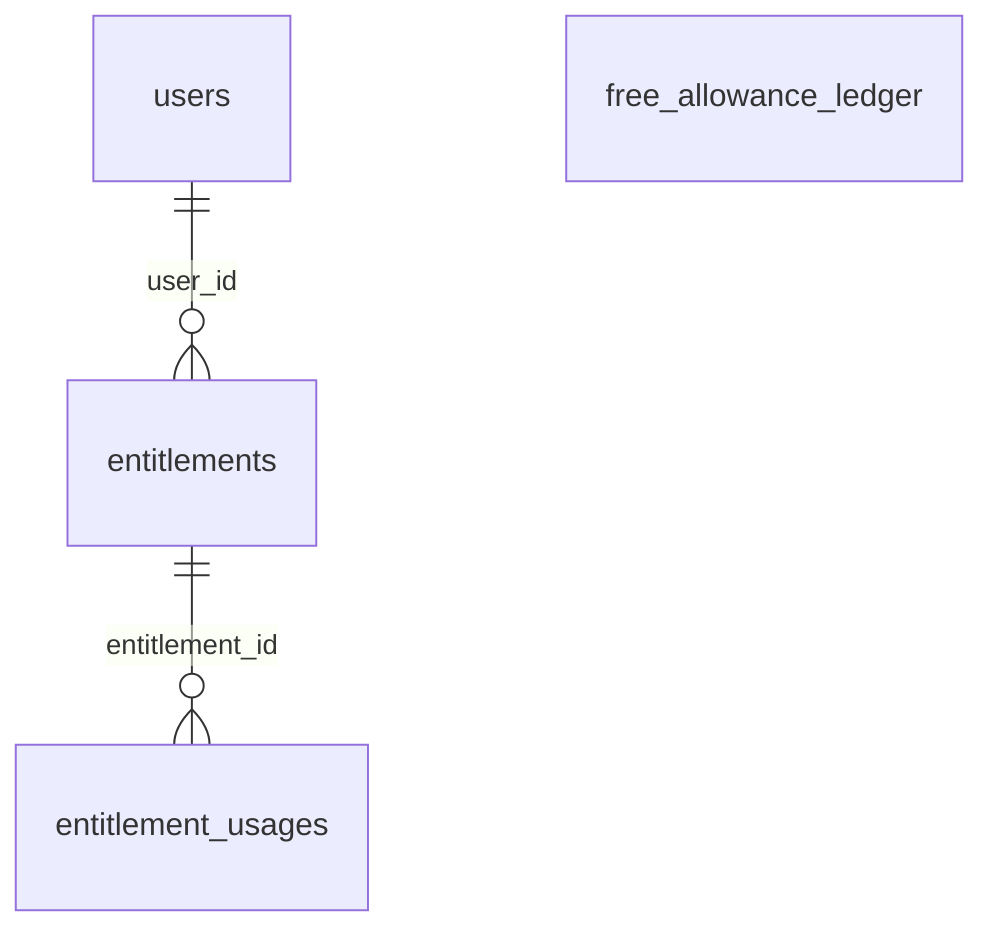

# Entitlements and the Free ledger

:::info[Generated page]

Generated by `npm run sync` from **bachelor-house-backend** `chore/scaffold-from-reference`. Don't edit it by hand: the next sync overwrites it.
:::

3 tables owned by `src/modules/entitlements`: [`entitlement_usages`](#entitlement-usages), [`entitlements`](#entitlements), [`free_allowance_ledger`](#free-allowance-ledger).

## `entitlement_usages` \{#entitlement-usages\}

Doc 03 section 9. One row per spend; the unique key per subject makes a retry a no-op.

Defined in [`src/modules/entitlements/entitlements.table.ts`](https://github.com/oplifyterminal/bachelor-house-backend/blob/chore/scaffold-from-reference/src/modules/entitlements/entitlements.table.ts).

| Column | Type | Null | Default | Notes |
| --- | --- | --- | --- | --- |
| `id` | `uuid` |  | `gen_random_uuid()` | PK |
| `entitlement_id` | `uuid` |  |  | → `entitlements.id` (on delete restrict) |
| `kind` | `entitlement_kind` |  |  |  |
| `subject_type` | `text` |  |  |  |
| `subject_id` | `uuid` |  |  |  |
| `quantity` | `integer` |  | `1` |  |
| `reversed_at` | `timestamp with time zone` | yes |  |  |
| `reversed_reason` | `text` | yes |  |  |
| `created_at` | `timestamp with time zone` |  | `now()` |  |

Constraints and indexes

- **Check** `entitlement_usages_quantity_positive`: `entitlement_usages.quantity > 0`
- **Unique index** `entitlement_usages_subject_key` (btree): `subject_type, subject_id` where `entitlement_usages.reversed_at IS NULL`
- **Index** `entitlement_usages_entitlement_idx` (btree): `entitlement_id`

## `entitlements` \{#entitlements\}

Doc 03 section 9. Countable quotas only. `listing_id` and `subscription_id` are plain uuids until the listings (T-11x) and subscriptions (T-2xx) tables exist; the migration that adds them adds the FKs.

Defined in [`src/modules/entitlements/entitlements.table.ts`](https://github.com/oplifyterminal/bachelor-house-backend/blob/chore/scaffold-from-reference/src/modules/entitlements/entitlements.table.ts).

| Column | Type | Null | Default | Notes |
| --- | --- | --- | --- | --- |
| `id` | `uuid` |  | `gen_random_uuid()` | PK |
| `user_id` | `uuid` |  |  | → `users.id` (on delete restrict) |
| `listing_id` | `uuid` | yes |  |  |
| `subscription_id` | `uuid` | yes |  |  |
| `kind` | `entitlement_kind` |  |  |  |
| `source` | `entitlement_source` |  |  |  |
| `granted` | `integer` |  |  |  |
| `used` | `integer` |  | `0` |  |
| `reserved` | `integer` |  | `0` |  |
| `valid_from` | `timestamp with time zone` |  | `now()` |  |
| `valid_until` | `timestamp with time zone` | yes |  |  |
| `status` | `entitlement_status` |  | `'active'` |  |
| `revoked_reason` | `text` | yes |  |  |
| `created_at` | `timestamp with time zone` |  | `now()` |  |
| `updated_at` | `timestamp with time zone` |  | `now()` |  |

Constraints and indexes

- **Check** `entitlements_quota_within_grant`: `entitlements.used >= 0 AND entitlements.reserved >= 0 AND entitlements.used + entitlements.reserved <= entitlements.granted`
- **Check** `entitlements_granted_nonneg`: `entitlements.granted >= 0`
- **Unique index** `entitlements_subscription_kind_key` (btree): `subscription_id, kind` where `entitlements.subscription_id IS NOT NULL`
- **Unique index** `entitlements_free_listing_kind_key` (btree): `listing_id, kind` where `entitlements.source = 'free_tier'`
- **Index** `entitlements_listing_kind_status_idx` (btree): `listing_id, kind, status`
- **Index** `entitlements_user_kind_status_idx` (btree): `user_id, kind, status`

## `free_allowance_ledger` \{#free-allowance-ledger\}

Doc 03 section 3 (BR-AUTH-14). Keyed by the HMAC of the phone and tied to no user row, so account deletion and re-registration reset nothing. `owner_free_listing_id` has no FK for the same reason.

Defined in [`src/modules/entitlements/entitlements.table.ts`](https://github.com/oplifyterminal/bachelor-house-backend/blob/chore/scaffold-from-reference/src/modules/entitlements/entitlements.table.ts).

| Column | Type | Null | Default | Notes |
| --- | --- | --- | --- | --- |
| `phone_hmac` | `bytea` |  |  | PK |
| `contact_credits_used` | `smallint` |  | `0` |  |
| `owner_free_state` | `text` |  | `'available'` |  |
| `owner_free_listing_id` | `uuid` | yes |  |  |
| `owner_free_changed_at` | `timestamp with time zone` | yes |  |  |
| `suspended_at` | `timestamp with time zone` | yes |  |  |
| `suspension_reason` | `text` | yes |  |  |
| `updated_at` | `timestamp with time zone` |  | `now()` |  |

Constraints and indexes

- **Check** `free_allowance_credits_nonneg`: `free_allowance_ledger.contact_credits_used >= 0`
- **Check** `free_allowance_owner_state_listing`: `free_allowance_ledger.owner_free_state = 'available' OR free_allowance_ledger.owner_free_listing_id IS NOT NULL`

