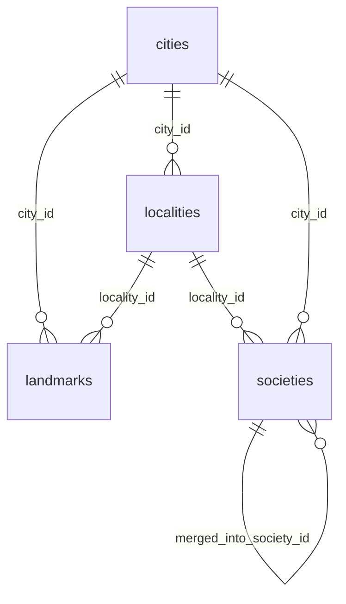

# Places

:::info[Generated page]

Generated by `npm run sync` from **bachelor-house-backend** `chore/scaffold-from-reference`. Don't edit it by hand: the next sync overwrites it.
:::

4 tables owned by `src/modules/geo`: [`cities`](#cities), [`landmarks`](#landmarks), [`localities`](#localities), [`societies`](#societies).

## `cities` \{#cities\}

Doc 03 section 5. Master data: staff deactivate rows, they never delete them (AD47).

Defined in [`src/modules/geo/geo.table.ts`](https://github.com/oplifyterminal/bachelor-house-backend/blob/chore/scaffold-from-reference/src/modules/geo/geo.table.ts).

| Column | Type | Null | Default | Notes |
| --- | --- | --- | --- | --- |
| `id` | `uuid` |  | `gen_random_uuid()` | PK |
| `name` | `text` |  |  |  |
| `slug` | `text` |  |  |  |
| `state_name` | `text` |  |  |  |
| `state_code` | `text` |  |  |  |
| `centroid` | `geography(Point,4326)` |  |  |  |
| `is_active` | `boolean` |  | `true` |  |
| `sort_order` | `integer` |  | `0` |  |
| `created_at` | `timestamp with time zone` |  | `now()` |  |
| `updated_at` | `timestamp with time zone` |  | `now()` |  |

Constraints and indexes

- **Unique** `cities_slug_unique`: (`slug`)

## `landmarks` \{#landmarks\}

Defined in [`src/modules/geo/geo.table.ts`](https://github.com/oplifyterminal/bachelor-house-backend/blob/chore/scaffold-from-reference/src/modules/geo/geo.table.ts).

| Column | Type | Null | Default | Notes |
| --- | --- | --- | --- | --- |
| `id` | `uuid` |  | `gen_random_uuid()` | PK |
| `city_id` | `uuid` |  |  | → `cities.id` (on delete restrict) |
| `locality_id` | `uuid` | yes |  | → `localities.id` (on delete restrict) |
| `name` | `text` |  |  |  |
| `type` | `text` |  |  |  |
| `location` | `geography(Point,4326)` |  |  |  |
| `aliases` | `text[]` |  | `'{}'::text[]` |  |
| `is_active` | `boolean` |  | `true` |  |
| `created_at` | `timestamp with time zone` |  | `now()` |  |
| `updated_at` | `timestamp with time zone` |  | `now()` |  |

Constraints and indexes

- **Unique** `landmarks_cityId_name_unique`: (`city_id`, `name`)
- **Check** `landmarks_type_check`: `landmarks.type in ('college','it_park','metro_station','railway_station','bus_stand','mall','hospital','office_hub','other')`
- **Index** `landmarks_name_trgm_idx` (gin): `"name" gin_trgm_ops`
- **Index** `landmarks_name_norm_trgm_idx` (gin): `bh_norm("name") gin_trgm_ops`
- **Index** `landmarks_aliases_norm_trgm_idx` (gin): `bh_norm_aliases("aliases") gin_trgm_ops`
- **Index** `landmarks_location_gist_idx` (gist): `location`

## `localities` \{#localities\}

Defined in [`src/modules/geo/geo.table.ts`](https://github.com/oplifyterminal/bachelor-house-backend/blob/chore/scaffold-from-reference/src/modules/geo/geo.table.ts).

| Column | Type | Null | Default | Notes |
| --- | --- | --- | --- | --- |
| `id` | `uuid` |  | `gen_random_uuid()` | PK |
| `city_id` | `uuid` |  |  | → `cities.id` (on delete restrict) |
| `name` | `text` |  |  |  |
| `slug` | `text` |  |  |  |
| `aliases` | `text[]` |  | `'{}'::text[]` |  |
| `pincodes` | `text[]` |  | `'{}'::text[]` |  |
| `centroid` | `geography(Point,4326)` |  |  |  |
| `is_active` | `boolean` |  | `true` |  |
| `created_at` | `timestamp with time zone` |  | `now()` |  |
| `updated_at` | `timestamp with time zone` |  | `now()` |  |

Constraints and indexes

- **Unique** `localities_cityId_slug_unique`: (`city_id`, `slug`)
- **Index** `localities_name_trgm_idx` (gin): `"name" gin_trgm_ops`
- **Index** `localities_name_norm_trgm_idx` (gin): `bh_norm("name") gin_trgm_ops`
- **Index** `localities_aliases_norm_trgm_idx` (gin): `bh_norm_aliases("aliases") gin_trgm_ops`
- **Index** `localities_centroid_gist_idx` (gist): `centroid`

## `societies` \{#societies\}

Typed by listers, cleaned up by staff (AD48). `normalisedName` is the dedupe key within a locality.

Defined in [`src/modules/geo/geo.table.ts`](https://github.com/oplifyterminal/bachelor-house-backend/blob/chore/scaffold-from-reference/src/modules/geo/geo.table.ts).

| Column | Type | Null | Default | Notes |
| --- | --- | --- | --- | --- |
| `id` | `uuid` |  | `gen_random_uuid()` | PK |
| `city_id` | `uuid` |  |  | → `cities.id` (on delete restrict) |
| `locality_id` | `uuid` |  |  | → `localities.id` (on delete restrict) |
| `name` | `text` |  |  |  |
| `normalised_name` | `text` |  |  |  |
| `aliases` | `text[]` |  | `'{}'::text[]` |  |
| `location` | `geography(Point,4326)` | yes |  |  |
| `listing_count` | `integer` |  | `0` |  |
| `is_active` | `boolean` |  | `true` |  |
| `merged_into_society_id` | `uuid` | yes |  | → `societies.id` (on delete restrict) |
| `created_at` | `timestamp with time zone` |  | `now()` |  |

Constraints and indexes

- **Unique index** `societies_locality_name_key` (btree): `locality_id, normalised_name` where `societies.merged_into_society_id is null`
- **Index** `societies_city_id_idx` (btree): `city_id`
- **Index** `societies_name_trgm_idx` (gin): `"name" gin_trgm_ops`
- **Index** `societies_name_norm_trgm_idx` (gin): `bh_norm("name") gin_trgm_ops`
- **Index** `societies_aliases_norm_trgm_idx` (gin): `bh_norm_aliases("aliases") gin_trgm_ops`

