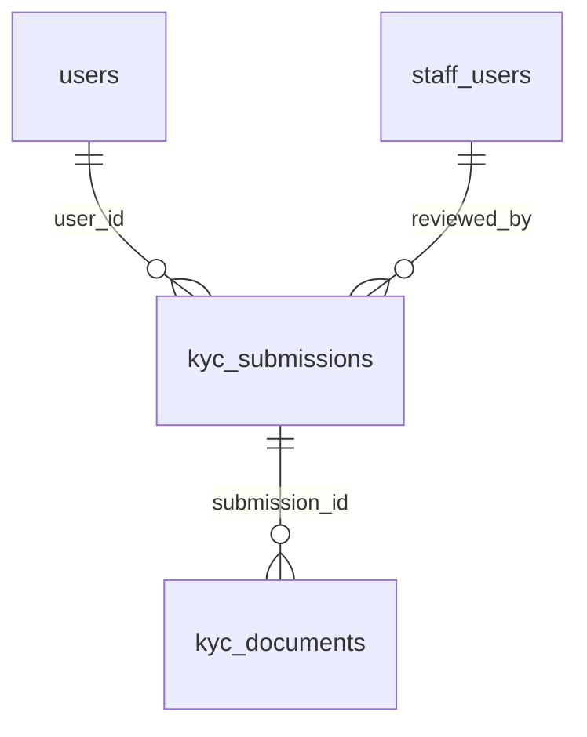

# KYC

:::info[Generated page]

Generated by `npm run sync` from **bachelor-house-backend** `chore/scaffold-from-reference`. Don't edit it by hand: the next sync overwrites it.
:::

2 tables owned by `src/modules/kyc`: [`kyc_documents`](#kyc-documents), [`kyc_submissions`](#kyc-submissions).

## `kyc_documents` \{#kyc-documents\}

One row per stored file. The file lives in the private KMS bucket; the key is never returned to a client. Staff see it only through a 60-second link that writes `kyc.document.view`.

Defined in [`src/modules/kyc/kyc.table.ts`](https://github.com/oplifyterminal/bachelor-house-backend/blob/chore/scaffold-from-reference/src/modules/kyc/kyc.table.ts).

| Column | Type | Null | Default | Notes |
| --- | --- | --- | --- | --- |
| `id` | `uuid` |  | `gen_random_uuid()` | PK |
| `submission_id` | `uuid` |  |  | → `kyc_submissions.id` (on delete cascade) |
| `doc_role` | `text` |  |  |  |
| `doc_type` | `text` |  |  |  |
| `bucket` | `text` |  |  |  |
| `object_key` | `text` |  |  |  |
| `content_type` | `text` |  |  |  |
| `size_bytes` | `bigint` |  |  |  |
| `sha256` | `text` |  |  |  |
| `purged_at` | `timestamp with time zone` | yes |  |  |
| `created_at` | `timestamp with time zone` |  | `now()` |  |

Constraints and indexes

- **Check** `kyc_documents_role_check`: `doc_role IN ('id_proof','ownership_proof','selfie_at_property','business_proof','rera_certificate','authorisation_proof')`
- **Unique index** `kyc_documents_submission_role_idx` (btree): `submission_id, doc_role`
- **Unique index** `kyc_documents_object_idx` (btree): `bucket, object_key`

## `kyc_submissions` \{#kyc-submissions\}

Doc 03 section 7. KYC belongs to the lister, not the listing (BR-KYC-04). Only the last 4 characters of an ID number are ever stored (BR-KYC-03); the full number never reaches the server.

Defined in [`src/modules/kyc/kyc.table.ts`](https://github.com/oplifyterminal/bachelor-house-backend/blob/chore/scaffold-from-reference/src/modules/kyc/kyc.table.ts).

| Column | Type | Null | Default | Notes |
| --- | --- | --- | --- | --- |
| `id` | `uuid` |  | `gen_random_uuid()` | PK |
| `user_id` | `uuid` |  |  | → `users.id` (on delete restrict) |
| `subject_type` | `text` |  |  |  |
| `status` | `kyc_status` |  | `'submitted'` |  |
| `id_doc_type` | `text` | yes |  |  |
| `id_number_last4` | `text` | yes |  |  |
| `ownership_doc_type` | `text` | yes |  |  |
| `address_text` | `text` | yes |  |  |
| `decision_reason` | `text` | yes |  |  |
| `reviewed_by` | `uuid` | yes |  | → `staff_users.id` (on delete set null) |
| `reviewed_at` | `timestamp with time zone` | yes |  |  |
| `files_purge_after` | `timestamp with time zone` | yes |  |  |
| `created_at` | `timestamp with time zone` |  | `now()` |  |
| `updated_at` | `timestamp with time zone` |  | `now()` |  |

Constraints and indexes

- **Check** `kyc_submissions_last4_check`: `kyc_submissions.id_number_last4 IS NULL OR char_length(kyc_submissions.id_number_last4) = 4`
- **Check** `kyc_submissions_subject_check`: `subject_type IN ('pg_lister','agent_identity','agent_business','agent_rera','ownership_dispute','agent_authorisation')`
- **Index** `kyc_submissions_user_status_idx` (btree): `user_id, status`
- **Index** `kyc_submissions_status_created_idx` (btree): `status, created_at`
- **Index** `kyc_submissions_purge_idx` (btree): `files_purge_after` where `kyc_submissions.files_purge_after IS NOT NULL`
- **Unique index** `kyc_submissions_one_open_idx` (btree): `user_id, subject_type, coalesce("address_text", '')` where `kyc_submissions.status IN ('submitted','under_review')`

