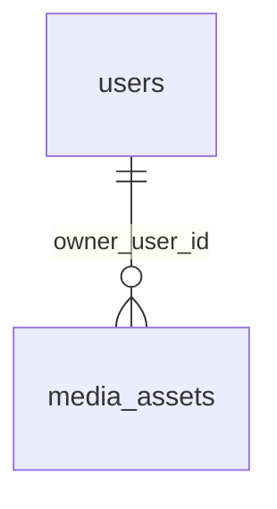

# Media

:::info[Generated page]

Generated by `npm run sync` from **bachelor-house-backend** `chore/scaffold-from-reference`. Don't edit it by hand: the next sync overwrites it.
:::

1 table owned by `src/modules/media`: [`media_assets`](#media-assets).

## `media_assets` \{#media-assets\}

Doc 03 section on `media_assets`. One row per uploaded file. The browser uploads straight to storage (BR-MED-01); the row tracks it from the signed form to the processed variants. Listing media, KYC documents and the agent photo point at this table by id.

Defined in [`src/modules/media/media.table.ts`](https://github.com/oplifyterminal/bachelor-house-backend/blob/chore/scaffold-from-reference/src/modules/media/media.table.ts).

| Column | Type | Null | Default | Notes |
| --- | --- | --- | --- | --- |
| `id` | `uuid` |  | `gen_random_uuid()` | PK |
| `owner_user_id` | `uuid` | yes |  | → `users.id` (on delete restrict) |
| `purpose` | `media_purpose` |  |  |  |
| `status` | `media_status` |  | `'awaiting_upload'` |  |
| `declared_type` | `text` |  |  |  |
| `detected_type` | `text` | yes |  |  |
| `size_bytes` | `bigint` |  |  |  |
| `bucket` | `text` |  |  |  |
| `original_key` | `text` |  |  |  |
| `variants` | `jsonb` | yes |  |  |
| `width` | `integer` | yes |  |  |
| `height` | `integer` | yes |  |  |
| `duration_seconds` | `integer` | yes |  |  |
| `phash` | `bigint` | yes |  |  |
| `blur_placeholder` | `text` | yes |  |  |
| `reject_reason` | `text` | yes |  |  |
| `processed_at` | `timestamp with time zone` | yes |  |  |
| `created_at` | `timestamp with time zone` |  | `now()` |  |
| `updated_at` | `timestamp with time zone` |  | `now()` |  |

Constraints and indexes

- **Index** `media_assets_status_updated_idx` (btree): `status, updated_at`
- **Index** `media_assets_phash_idx` (btree): `phash`
- **Index** `media_assets_owner_created_idx` (btree): `owner_user_id, created_at`

