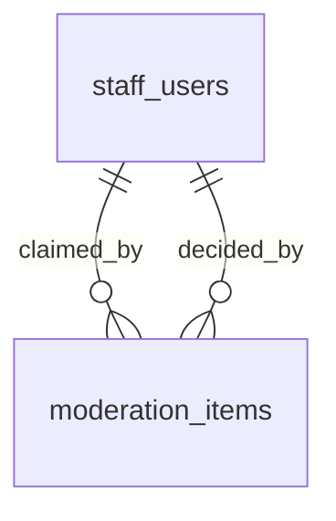

# Moderation

:::info[Generated page]

Generated by `npm run sync` from **bachelor-house-backend** `chore/scaffold-from-reference`. Don't edit it by hand: the next sync overwrites it.
:::

1 table owned by `src/modules/moderation`: [`moderation_items`](#moderation-items).

## `moderation_items` \{#moderation-items\}

Doc 03 section 6, `moderation_items`: the staff queue (AD7 to AD10 read and decide on it).

Defined in [`src/modules/moderation/moderation.table.ts`](https://github.com/oplifyterminal/bachelor-house-backend/blob/chore/scaffold-from-reference/src/modules/moderation/moderation.table.ts).

| Column | Type | Null | Default | Notes |
| --- | --- | --- | --- | --- |
| `id` | `uuid` |  | `gen_random_uuid()` | PK |
| `subject_type` | `moderation_subject` |  |  |  |
| `subject_id` | `uuid` |  |  |  |
| `reason` | `text` |  |  |  |
| `flags` | `jsonb` |  | `'{}'::jsonb` |  |
| `priority` | `smallint` |  | `0` |  |
| `status` | `moderation_status` |  | `'open'` |  |
| `claimed_by` | `uuid` | yes |  | → `staff_users.id` (on delete set null) |
| `claimed_at` | `timestamp with time zone` | yes |  |  |
| `decision` | `moderation_decision` | yes |  |  |
| `decision_reason_code` | `text` | yes |  |  |
| `decision_note` | `text` | yes |  |  |
| `decided_by` | `uuid` | yes |  | → `staff_users.id` (on delete set null) |
| `decided_at` | `timestamp with time zone` | yes |  |  |
| `created_at` | `timestamp with time zone` |  | `now()` |  |

Constraints and indexes

- **Check** `moderation_items_reason_check`: `moderation_items.reason IN ('first_listing','pg','agent_first_five','auto_flag','report','sensitive_edit','reactivation','possible_duplicate','ownership_dispute','agent_verification')`
- **Unique index** `moderation_items_open_subject_key` (btree): `subject_type, subject_id` where `moderation_items.status <> 'decided'`
- **Index** `moderation_items_queue_idx` (btree): `status, priority, created_at`

