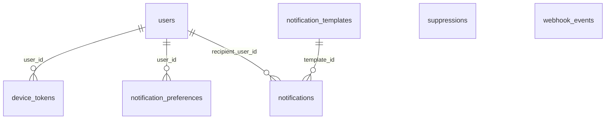

# Notifications

:::info[Generated page]

Generated by `npm run sync` from **bachelor-house-backend** `chore/scaffold-from-reference`. Don't edit it by hand: the next sync overwrites it.
:::

6 tables owned by `src/modules/notifications`: [`device_tokens`](#device-tokens), [`notification_preferences`](#notification-preferences), [`notification_templates`](#notification-templates), [`notifications`](#notifications), [`suppressions`](#suppressions), [`webhook_events`](#webhook-events).

## `device_tokens` \{#device-tokens\}

Doc 03 `device_tokens` (BR-NTF-01, app push). One row per push token. `familyId` is the sign-in (sessions.family_id) the token was registered from: push goes only to tokens whose sign-in is still live, so logging out, revoking a device or reusing a refresh token stops push to it.

Defined in [`src/modules/notifications/notifications.table.ts`](https://github.com/oplifyterminal/bachelor-house-backend/blob/chore/scaffold-from-reference/src/modules/notifications/notifications.table.ts).

| Column | Type | Null | Default | Notes |
| --- | --- | --- | --- | --- |
| `id` | `uuid` |  | `gen_random_uuid()` | PK |
| `user_id` | `uuid` |  |  | → `users.id` (on delete cascade) |
| `family_id` | `uuid` |  |  |  |
| `platform` | `text` |  |  |  |
| `token` | `text` |  |  |  |
| `last_seen_at` | `timestamp with time zone` |  | `now()` |  |
| `created_at` | `timestamp with time zone` |  | `now()` |  |

Constraints and indexes

- **Unique** `device_tokens_token_unique`: (`token`)
- **Check** `device_tokens_platform_check`: `device_tokens.platform in ('ios', 'android', 'web')`
- **Index** `device_tokens_user_id_index` (btree): `user_id`

## `notification_preferences` \{#notification-preferences\}

Doc 03 section 3. Only a choice the user made is stored; a missing row means the group's default (see `notifications.preferences.ts`). Essential groups are never stored (BR-NTF-04).

Defined in [`src/modules/notifications/notifications.table.ts`](https://github.com/oplifyterminal/bachelor-house-backend/blob/chore/scaffold-from-reference/src/modules/notifications/notifications.table.ts).

| Column | Type | Null | Default | Notes |
| --- | --- | --- | --- | --- |
| `user_id` | `uuid` |  |  | PK; → `users.id` (on delete cascade) |
| `event_group` | `text` |  |  | PK |
| `channel` | `notification_channel` |  |  | PK |
| `enabled` | `boolean` |  |  |  |

## `notification_templates` \{#notification-templates\}

Doc 03 section 11. One row per event, channel, locale and version; a used version is never edited.

Defined in [`src/modules/notifications/notifications.table.ts`](https://github.com/oplifyterminal/bachelor-house-backend/blob/chore/scaffold-from-reference/src/modules/notifications/notifications.table.ts).

| Column | Type | Null | Default | Notes |
| --- | --- | --- | --- | --- |
| `id` | `uuid` |  | `gen_random_uuid()` | PK |
| `event_code` | `text` |  |  |  |
| `channel` | `notification_channel` |  |  |  |
| `locale` | `text` |  | `'en-IN'` |  |
| `version` | `integer` |  | `1` |  |
| `subject` | `text` | yes |  |  |
| `body` | `text` |  |  |  |
| `provider_template_id` | `text` | yes |  |  |
| `is_active` | `boolean` |  | `true` |  |
| `created_at` | `timestamp with time zone` |  | `now()` |  |

Constraints and indexes

- **Unique** `notification_templates_eventCode_channel_locale_version_unique`: (`event_code`, `channel`, `locale`, `version`)

## `notifications` \{#notifications\}

Doc 03 section 11. Inserted in the same transaction as the business event (BR-NTF-05, doc 02 6.9).

Defined in [`src/modules/notifications/notifications.table.ts`](https://github.com/oplifyterminal/bachelor-house-backend/blob/chore/scaffold-from-reference/src/modules/notifications/notifications.table.ts).

| Column | Type | Null | Default | Notes |
| --- | --- | --- | --- | --- |
| `id` | `uuid` |  | `gen_random_uuid()` | PK |
| `event_code` | `text` |  |  |  |
| `recipient_user_id` | `uuid` | yes |  | → `users.id` (on delete restrict) |
| `recipient_address` | `text` | yes |  |  |
| `channel` | `notification_channel` |  |  |  |
| `template_id` | `uuid` | yes |  | → `notification_templates.id` (on delete restrict) |
| `payload` | `jsonb` |  | `'{}'::jsonb` |  |
| `status` | `notification_status` |  | `'queued'` |  |
| `scheduled_for` | `timestamp with time zone` |  | `now()` |  |
| `attempts` | `smallint` |  | `0` |  |
| `last_error` | `text` | yes |  |  |
| `provider_message_id` | `text` | yes |  |  |
| `dedupe_key` | `text` | yes |  |  |
| `sent_at` | `timestamp with time zone` | yes |  |  |
| `delivered_at` | `timestamp with time zone` | yes |  |  |
| `read_at` | `timestamp with time zone` | yes |  |  |
| `created_at` | `timestamp with time zone` |  | `now()` |  |

Constraints and indexes

- **Index** `notifications_status_scheduled_for_index` (btree): `status, scheduled_for`
- **Index** `notifications_recipient_user_id_channel_created_at_index` (btree): `recipient_user_id, channel, created_at`
- **Index** `notifications_provider_message_id_index` (btree): `provider_message_id`
- **Unique index** `notifications_dedupe_key_index` (btree): `dedupe_key`

## `suppressions` \{#suppressions\}

Doc 03 section 11. Checked before every send: a suppressed address is never sent to.

Defined in [`src/modules/notifications/notifications.table.ts`](https://github.com/oplifyterminal/bachelor-house-backend/blob/chore/scaffold-from-reference/src/modules/notifications/notifications.table.ts).

| Column | Type | Null | Default | Notes |
| --- | --- | --- | --- | --- |
| `id` | `uuid` |  | `gen_random_uuid()` | PK |
| `channel` | `notification_channel` |  |  |  |
| `address_hash` | `text` |  |  |  |
| `reason` | `text` |  |  |  |
| `source` | `text` |  |  |  |
| `created_at` | `timestamp with time zone` |  | `now()` |  |

Constraints and indexes

- **Unique** `suppressions_channel_addressHash_unique`: (`channel`, `address_hash`)
- **Check** `suppressions_reason_check`: `suppressions.reason in ('unsubscribed', 'bounced', 'complained', 'dnd')`

## `webhook_events` \{#webhook-events\}

Doc 03 section 11. One row per provider event; the unique key makes a replayed webhook a no-op.

Defined in [`src/modules/notifications/notifications.table.ts`](https://github.com/oplifyterminal/bachelor-house-backend/blob/chore/scaffold-from-reference/src/modules/notifications/notifications.table.ts).

| Column | Type | Null | Default | Notes |
| --- | --- | --- | --- | --- |
| `id` | `uuid` |  | `gen_random_uuid()` | PK |
| `provider` | `text` |  |  |  |
| `event_id` | `text` |  |  |  |
| `event_type` | `text` |  |  |  |
| `signature_valid` | `boolean` |  |  |  |
| `payload` | `jsonb` |  |  |  |
| `status` | `text` |  | `'received'` |  |
| `attempts` | `smallint` |  | `0` |  |
| `error` | `text` | yes |  |  |
| `received_at` | `timestamp with time zone` |  | `now()` |  |
| `processed_at` | `timestamp with time zone` | yes |  |  |

Constraints and indexes

- **Unique** `webhook_events_provider_eventId_unique`: (`provider`, `event_id`)
- **Check** `webhook_events_provider_check`: `webhook_events.provider in ('razorpay', 'msg91', 'whatsapp', 'brevo')`
- **Check** `webhook_events_status_check`: `webhook_events.status in ('received', 'processed', 'failed', 'ignored')`

