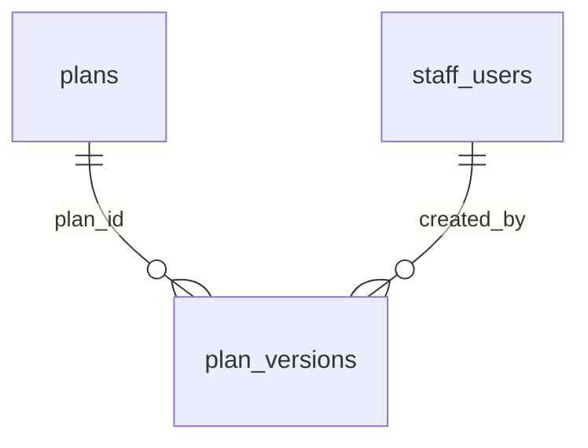

# Plans

:::info[Generated page]

Generated by `npm run sync` from **bachelor-house-backend** `chore/scaffold-from-reference`. Don't edit it by hand: the next sync overwrites it.
:::

2 tables owned by `src/modules/plans`: [`plan_versions`](#plan-versions), [`plans`](#plans).

## `plan_versions` \{#plan-versions\}

Doc 03 section 9. One row per sellable version. Once a version leaves `draft` a trigger rejects changes to its price, term, quota and feature columns (BR-PLN-08, BR-CFG-03); only `status` and `effective_until` may move. At most one published version per plan is sellable at any moment (exclusion constraint). Both live in the migration, which also checks for orders once T-204 adds them.

Defined in [`src/modules/plans/plans.table.ts`](https://github.com/oplifyterminal/bachelor-house-backend/blob/chore/scaffold-from-reference/src/modules/plans/plans.table.ts).

| Column | Type | Null | Default | Notes |
| --- | --- | --- | --- | --- |
| `id` | `uuid` |  | `gen_random_uuid()` | PK |
| `plan_id` | `uuid` |  |  | → `plans.id` (on delete restrict) |
| `version` | `integer` |  |  |  |
| `name` | `text` |  |  |  |
| `tagline` | `text` | yes |  |  |
| `reference_price_paise` | `bigint` | yes |  |  |
| `reference_price_note` | `text` | yes |  |  |
| `price_paise` | `bigint` |  |  |  |
| `gst_rate_bp` | `integer` |  | `1800` |  |
| `sac_code` | `text` | yes |  |  |
| `validity_days` | `integer` |  |  |  |
| `listing_duration_days` | `integer` | yes |  |  |
| `slot_limit` | `integer` | yes |  |  |
| `matching_quota` | `integer` | yes |  |  |
| `boost_count` | `integer` |  | `0` |  |
| `boost_duration_hours` | `integer` |  | `0` |  |
| `promo_tier` | `promo_tier` |  | `'none'` |  |
| `includes_shoot` | `boolean` |  | `false` |  |
| `features` | `jsonb` |  | `'{}'::jsonb` |  |
| `effective_from` | `timestamp with time zone` |  | `now()` |  |
| `effective_until` | `timestamp with time zone` | yes |  |  |
| `status` | `text` |  | `'draft'` |  |
| `created_by` | `uuid` | yes |  | → `staff_users.id` (on delete set null) |
| `created_at` | `timestamp with time zone` |  | `now()` |  |

Constraints and indexes

- **Unique** `plan_versions_plan_version_unique`: (`plan_id`, `version`)
- **Check** `plan_versions_status_check`: `plan_versions.status IN ('draft', 'published', 'retired')`
- **Check** `plan_versions_price_nonneg`: `plan_versions.price_paise >= 0`
- **Check** `plan_versions_reference_above_price`: `plan_versions.reference_price_paise IS NULL OR plan_versions.reference_price_paise > plan_versions.price_paise`
- **Check** `plan_versions_reference_note`: `plan_versions.reference_price_paise IS NULL OR length(btrim(coalesce(plan_versions.reference_price_note, ''))) > 0`
- **Check** `plan_versions_gst_range`: `plan_versions.gst_rate_bp BETWEEN 0 AND 10000`
- **Check** `plan_versions_validity_positive`: `plan_versions.validity_days > 0`
- **Check** `plan_versions_quotas_nonneg`: `coalesce(plan_versions.listing_duration_days, 1) > 0 AND coalesce(plan_versions.slot_limit, 0) >= 0
        AND coalesce(plan_versions.matching_quota, 0) >= 0 AND plan_versions.boost_count >= 0 AND plan_versions.boost_duration_hours >= 0`
- **Check** `plan_versions_window`: `plan_versions.effective_until IS NULL OR plan_versions.effective_until > plan_versions.effective_from`

## `plans` \{#plans\}

Doc 03 section 9. The product line; prices and terms live in `plan_versions`.

Defined in [`src/modules/plans/plans.table.ts`](https://github.com/oplifyterminal/bachelor-house-backend/blob/chore/scaffold-from-reference/src/modules/plans/plans.table.ts).

| Column | Type | Null | Default | Notes |
| --- | --- | --- | --- | --- |
| `id` | `uuid` |  | `gen_random_uuid()` | PK |
| `code` | `text` |  |  |  |
| `audience` | `plan_audience` |  |  |  |
| `scope` | `plan_scope` |  |  |  |
| `tier_rank` | `smallint` |  |  |  |
| `is_visible` | `boolean` |  | `true` |  |
| `sort_order` | `smallint` |  | `0` |  |
| `created_at` | `timestamp with time zone` |  | `now()` |  |

Constraints and indexes

- **Unique** `plans_code_unique`: (`code`)
- **Check** `plans_tier_rank_positive`: `plans.tier_rank > 0`
- **Check** `plans_audience_scope`: `(plans.audience::text IN ('owner', 'pg') AND plans.scope = 'listing')
        OR (plans.audience::text = 'agent' AND plans.scope = 'city')
        OR (plans.audience::text = 'tenant' AND plans.scope = 'account')`

