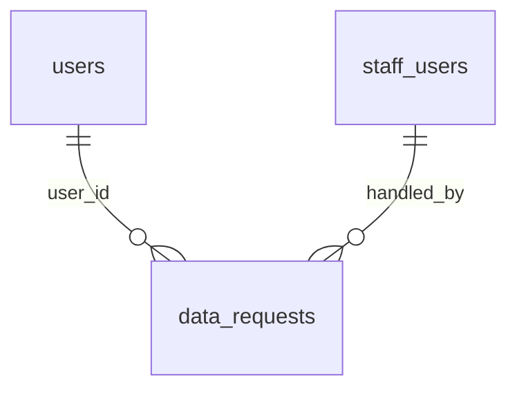

# Privacy requests

:::info[Generated page]

Generated by `npm run sync` from **bachelor-house-backend** `chore/scaffold-from-reference`. Don't edit it by hand: the next sync overwrites it.
:::

1 table owned by `src/modules/privacy`: [`data_requests`](#data-requests).

## `data_requests` \{#data-requests\}

Doc 03 `data_requests` (BR-CMP-01, BR-CMP-03): DPDP rights and grievances. `due_at` defaults to 30 days after creation, which is also the grace period before an erasure request is carried out. The row outlives the erasure of the user it belongs to.

Defined in [`src/modules/privacy/privacy.table.ts`](https://github.com/oplifyterminal/bachelor-house-backend/blob/chore/scaffold-from-reference/src/modules/privacy/privacy.table.ts).

| Column | Type | Null | Default | Notes |
| --- | --- | --- | --- | --- |
| `id` | `uuid` |  | `gen_random_uuid()` | PK |
| `user_id` | `uuid` |  |  | → `users.id` (on delete restrict) |
| `type` | `data_request_type` |  |  |  |
| `status` | `ticket_status` |  | `'new'` |  |
| `details` | `text` | yes |  |  |
| `response` | `text` | yes |  |  |
| `due_at` | `timestamp with time zone` |  | `now() + interval '30 days'` |  |
| `closed_at` | `timestamp with time zone` | yes |  |  |
| `handled_by` | `uuid` | yes |  | → `staff_users.id` (on delete set null) |
| `created_at` | `timestamp with time zone` |  | `now()` |  |
| `updated_at` | `timestamp with time zone` |  | `now()` |  |

Constraints and indexes

- **Index** `data_requests_status_due_idx` (btree): `status, due_at`
- **Index** `data_requests_user_idx` (btree): `user_id, created_at`
- **Unique index** `data_requests_open_erasure_key` (btree): `user_id` where `data_requests.type = 'erasure' AND data_requests.status <> 'closed'`

