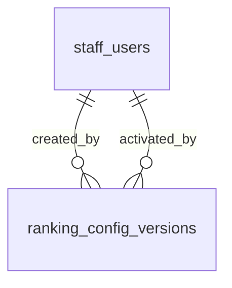

# Ranking

:::info[Generated page]

Generated by `npm run sync` from **bachelor-house-backend** `chore/scaffold-from-reference`. Don't edit it by hand: the next sync overwrites it.
:::

1 table owned by `src/modules/ranking`: [`ranking_config_versions`](#ranking-config-versions).

## `ranking_config_versions` \{#ranking-config-versions\}

Doc 03 section 13. Ranking, quality and matching values, one row per version (BR-GEN-05, BR-CFG-02). A version that has been used is never edited; a change adds a new version. At most one version is active. Staff columns are null on the seeded first version.

Defined in [`src/modules/ranking/ranking.table.ts`](https://github.com/oplifyterminal/bachelor-house-backend/blob/chore/scaffold-from-reference/src/modules/ranking/ranking.table.ts).

| Column | Type | Null | Default | Notes |
| --- | --- | --- | --- | --- |
| `id` | `uuid` |  | `gen_random_uuid()` | PK |
| `version` | `integer` |  |  |  |
| `status` | `config_status` |  | `'draft'` |  |
| `values` | `jsonb` |  |  |  |
| `reason` | `text` |  |  |  |
| `created_by` | `uuid` | yes |  | → `staff_users.id` (on delete restrict) |
| `activated_by` | `uuid` | yes |  | → `staff_users.id` (on delete restrict) |
| `activated_at` | `timestamp with time zone` | yes |  |  |
| `created_at` | `timestamp with time zone` |  | `now()` |  |

Constraints and indexes

- **Check** `ranking_config_versions_reason_check`: `char_length(ranking_config_versions.reason) > 0`
- **Unique index** `ranking_config_versions_version_key` (btree): `version`
- **Unique index** `ranking_config_versions_one_active_key` (btree): `status` where `ranking_config_versions.status = 'active'`

