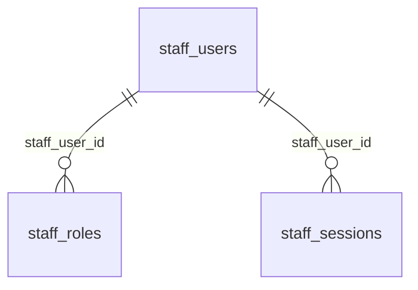

# Staff

:::info[Generated page]

Generated by `npm run sync` from **bachelor-house-backend** `chore/scaffold-from-reference`. Don't edit it by hand: the next sync overwrites it.
:::

3 tables owned by `src/modules/staff`: [`staff_roles`](#staff-roles), [`staff_sessions`](#staff-sessions), [`staff_users`](#staff-users).

## `staff_roles` \{#staff-roles\}

Defined in [`src/modules/staff/staff.table.ts`](https://github.com/oplifyterminal/bachelor-house-backend/blob/chore/scaffold-from-reference/src/modules/staff/staff.table.ts).

| Column | Type | Null | Default | Notes |
| --- | --- | --- | --- | --- |
| `staff_user_id` | `uuid` |  |  | PK; → `staff_users.id` (on delete cascade) |
| `role` | `staff_role` |  |  | PK |

## `staff_sessions` \{#staff-sessions\}

Same shape as customer `sessions`; `expiresAt` is the 8-hour absolute limit and never moves on rotation.

Defined in [`src/modules/staff/staff.table.ts`](https://github.com/oplifyterminal/bachelor-house-backend/blob/chore/scaffold-from-reference/src/modules/staff/staff.table.ts).

| Column | Type | Null | Default | Notes |
| --- | --- | --- | --- | --- |
| `id` | `uuid` |  | `gen_random_uuid()` | PK |
| `staff_user_id` | `uuid` |  |  | → `staff_users.id` (on delete cascade) |
| `family_id` | `uuid` |  |  |  |
| `refresh_token_hash` | `text` |  |  |  |
| `replaced_by_id` | `uuid` | yes |  |  |
| `user_agent` | `text` | yes |  |  |
| `ip` | `inet` | yes |  |  |
| `last_used_at` | `timestamp with time zone` |  | `now()` |  |
| `expires_at` | `timestamp with time zone` |  |  |  |
| `revoked_at` | `timestamp with time zone` | yes |  |  |
| `revoked_reason` | `text` | yes |  |  |
| `created_at` | `timestamp with time zone` |  | `now()` |  |

Constraints and indexes

- **Unique** `staff_sessions_refreshTokenHash_unique`: (`refresh_token_hash`)
- **Index** `staff_sessions_staff_user_id_index` (btree): `staff_user_id` where `staff_sessions.revoked_at IS NULL`
- **Index** `staff_sessions_family_id_index` (btree): `family_id`

## `staff_users` \{#staff-users\}

Doc 03 section 3 (staff_users). Separate from customer `users` (BR-AUTH-11).

Defined in [`src/modules/staff/staff.table.ts`](https://github.com/oplifyterminal/bachelor-house-backend/blob/chore/scaffold-from-reference/src/modules/staff/staff.table.ts).

| Column | Type | Null | Default | Notes |
| --- | --- | --- | --- | --- |
| `id` | `uuid` |  | `gen_random_uuid()` | PK |
| `email` | `citext` |  |  |  |
| `name` | `text` |  |  |  |
| `google_subject` | `text` | yes |  |  |
| `status` | `text` |  | `'active'` |  |
| `last_login_at` | `timestamp with time zone` | yes |  |  |
| `created_at` | `timestamp with time zone` |  | `now()` |  |
| `updated_at` | `timestamp with time zone` |  | `now()` |  |

Constraints and indexes

- **Unique** `staff_users_email_unique`: (`email`)
- **Unique** `staff_users_googleSubject_unique`: (`google_subject`)
- **Check** `staff_users_status_check`: `staff_users.status IN ('active', 'disabled')`

