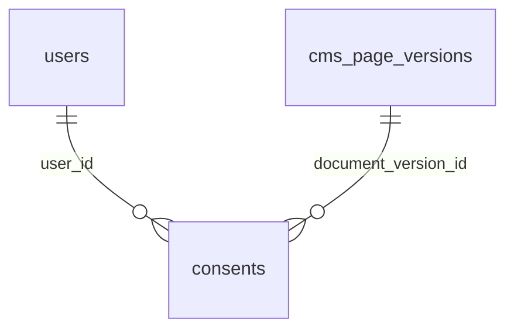

# Users and consents

:::info[Generated page]

Generated by `npm run sync` from **bachelor-house-backend** `chore/scaffold-from-reference`. Don't edit it by hand: the next sync overwrites it.
:::

2 tables owned by `src/modules/users`: [`consents`](#consents), [`users`](#users).

## `consents` \{#consents\}

Doc 03 `consents`: append-only. The current state for a user and purpose is the latest row.

Defined in [`src/modules/users/users.profile.table.ts`](https://github.com/oplifyterminal/bachelor-house-backend/blob/chore/scaffold-from-reference/src/modules/users/users.profile.table.ts).

| Column | Type | Null | Default | Notes |
| --- | --- | --- | --- | --- |
| `id` | `uuid` |  | `gen_random_uuid()` | PK |
| `user_id` | `uuid` | yes |  | → `users.id` |
| `subject_ref` | `text` | yes |  |  |
| `purpose` | `consent_purpose` |  |  |  |
| `granted` | `boolean` |  |  |  |
| `document_version` | `text` | yes |  |  |
| `document_version_id` | `uuid` | yes |  | → `cms_page_versions.id` (on delete restrict) |
| `context` | `jsonb` | yes |  |  |
| `source` | `text` |  |  |  |
| `ip` | `inet` | yes |  |  |
| `user_agent` | `text` | yes |  |  |
| `created_at` | `timestamp with time zone` |  | `now()` |  |

Constraints and indexes

- **Index** `consents_user_purpose_created_idx` (btree): `user_id, purpose, created_at`

## `users` \{#users\}

Defined in [`src/modules/users/users.table.ts`](https://github.com/oplifyterminal/bachelor-house-backend/blob/chore/scaffold-from-reference/src/modules/users/users.table.ts).

| Column | Type | Null | Default | Notes |
| --- | --- | --- | --- | --- |
| `id` | `uuid` |  | `gen_random_uuid()` | PK |
| `phone` | `text` | yes |  |  |
| `phone_verified_at` | `timestamp with time zone` | yes |  |  |
| `email` | `text` | yes |  |  |
| `email_verified_at` | `timestamp with time zone` | yes |  |  |
| `email_verification_token_hash` | `text` | yes |  |  |
| `email_verification_expires_at` | `timestamp with time zone` | yes |  |  |
| `name` | `text` | yes |  |  |
| `account_type` | `account_type` | yes |  |  |
| `adult_confirmed_at` | `timestamp with time zone` | yes |  |  |
| `status` | `user_status` |  | `'pending_profile'` |  |
| `last_login_at` | `timestamp with time zone` | yes |  |  |
| `deleted_at` | `timestamp with time zone` | yes |  |  |
| `created_at` | `timestamp with time zone` |  | `now()` |  |
| `updated_at` | `timestamp with time zone` |  | `now()` |  |

Constraints and indexes

- **Unique** `users_email_unique`: (`email`)
- **Unique index** `users_phone_active_key` (btree): `phone` where `users.deleted_at is null`
- **Index** `users_email_verification_token_idx` (btree): `email_verification_token_hash`

