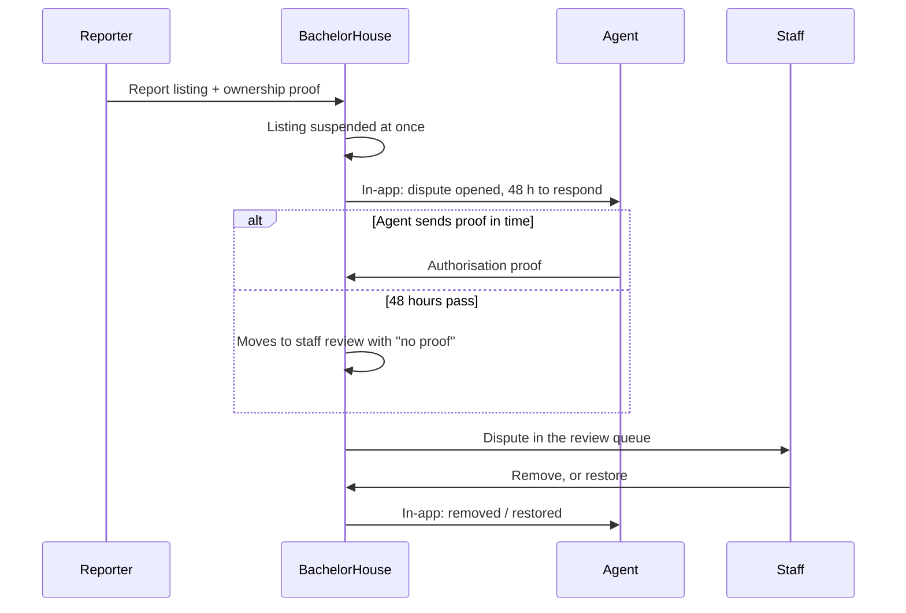

# Ownership disputes

If someone sees their property listed by an agent they never authorised, they can report it. The listing is **hidden straight away** while the agent is given 48 hours to prove they had permission.

## How it works

## Rules

| Rule | Detail |
| --- | --- |
| What can be reported | Only **agent** listings, and not your own. Others: `INVALID_STATE_TRANSITION`. |
| Proof from the reporter | One ownership proof document, stored like [KYC](../listing/pg-kyc.mdx) |
| Limit | Up to **3 open disputes** per reporter (`DISPUTE_LIMIT_REACHED`) |
| Effect | The listing is **suspended** immediately, with the reason "Reported as posted without the owner permission" |
| Agent's window | **48 hours** (a setting) to send an authorisation proof |
| No proof in time | A job every 5 minutes moves the dispute to staff review, marked as no proof |

## Staff decision

Staff with the right permission see disputes with both proofs and the 48-hour timer, then decide:

| Decision | Listing | Notes |
| --- | --- | --- |
| **Remove** | Stays suspended | The reporter's proof is approved |
| **Restore** | Back to the state it was in before the report | The days it was hidden are **added** to its end date and every other date it runs on. The agent's proof is approved. |

Proof files from both sides are deleted 180 days after the decision.

## Edge cases worth testing

- Report an owner's listing: refused.
- 4th open report by the same person: refused.
- Agent sends proof after 48 hours: the dispute is already with staff.
- Restore after 5 days hidden: the end date moves 5 days later.
