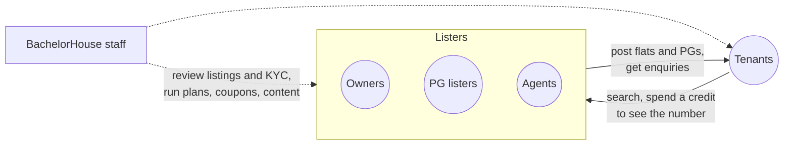

# How BachelorHouse works

BachelorHouse is a **rental marketplace for bachelors in Pune**: flats and PGs that welcome single tenants, listed by owners directly (or by agents, the only listers allowed to state a brokerage), with a free first listing for owners. This guide explains who can do what, the rules the platform enforces, what costs money, and how much of it is built today.

It's written for product managers, QA and anyone who needs to know how the product behaves without reading code. Every rule here was checked against the backend branch `chore/scaffold-from-reference` and the website's `main` branch.

## BachelorHouse in one picture

| Who | What they come for | How they pay |
| --- | --- | --- |
| **Tenants** | Find a bachelor-friendly flat or PG and reach the lister directly | 5 free contact credits for life, then a contact package (BH Connect, BH Plus, BH Max) |
| **Owners** | Rent out a flat, or run a PG, without paying a broker | One Free listing per phone number, then a listing plan (Starter Boost, Prime Connect, Elite Spotlight) |
| **PG listers** | Fill rooms and beds in a PG | Free listing as an owner, or a PG plan (PG Start, PG Boost, PG Prime) |
| **Agents** | List many properties on behalf of owners | A city plan with listing slots (Agent Starter, Agent Plus, Agent Elite) |
| **Staff** | Keep listings genuine and the platform running | Admin API (no admin website yet) |

A person signs up as exactly one of **tenant**, **owner** or **agent**. A PG lister is an owner or agent account that posts a PG listing.

## How BachelorHouse makes money

1. **Tenant contact packages.** After the 5 free contact credits, tenants buy a package of 15, 30 or 50 contacts.
2. **Listing plans.** Owners and PG listers buy a plan for one listing: more visibility, a featured badge, rank boosts and matching recommendations.
3. **Agent city plans.** Agents buy a plan for one city that gives them 30 to 60 listing slots.

All prices are in rupees before 18% GST, paid once through Razorpay, with no auto-renewal. See [Plans & pricing](./money/plans-and-pricing.mdx).

## Platform-wide principles

These hold across every feature. Keep them in mind when you write requirements or test cases.

| Principle | What it means in practice |
| --- | --- |
| **Phone numbers are the product** | A lister's number reaches a tenant only after the tenant spends a credit, and never appears on a listing or profile page. |
| **Every listing is checked** | First listings, every PG, and an agent's first 5 listings go to staff review. Anything that trips an automatic check goes to review too. |
| **The free allowance belongs to the phone number** | Free credits and the Free listing are tied to a hashed phone number, not the account. Deleting the account and signing up again does not give them back. |
| **Rules are configuration** | Limits such as 5 free credits, 30 Free days and the 48-hour dispute window are [settings](./platform/configurable-rules.mdx) staff can change without a release. Numbers in this guide are the launch defaults. |
| **Plans never change under a buyer** | A plan change creates a new version. Anyone who already bought keeps the version they paid for. |
| **The server is the referee** | Every rule in this guide is enforced by the backend, not just hidden in the website. |
| **Times are India time** | Dates, expiry, reminders and quiet hours use IST. |

## How to use this guide

- **New to the product:** read [What's built today](./build-status.mdx), then the [Journeys](/journeys) for the person you're building for.
- **Product managers:** the feature pages under each section list the rules and what is configurable.
- **QA:** most feature pages end with **edge cases worth testing**. [Known limitations](./known-limitations.md) lists what is missing on purpose, so you don't log it twice.
