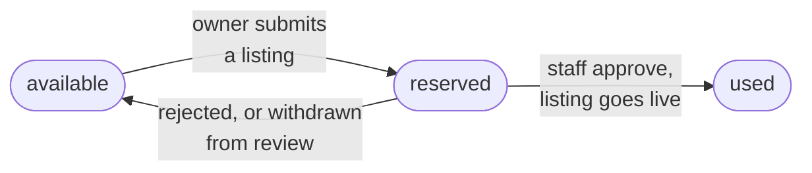

# Free listing

Every owner can list **one property free**: a flat or a PG. It runs for **30 days** from the moment staff approve it. After that, or for a second property, the owner needs a [plan](../money/plans-and-pricing.mdx).

## It belongs to the phone number

The allowance is stored against a one-way hash of the owner's phone number, not the account. So:

- `98765 43210` and `+91 98765 43210` are the same number and share one allowance.
- Deleting the account and signing up again with the same number does **not** give a new Free listing.
- The record survives account deletion. It holds only the hash, never the number.

The same ledger holds a tenant's [free contact credits](../tenants/contacting-a-lister.mdx).

## How the allowance moves

| Event | Effect |
| --- | --- |
| Owner submits a listing with no paid plan | The allowance is **reserved** for that listing. Submitting the same listing again keeps the same reservation. |
| Another listing is submitted while one is reserved or used | `PLAN_REQUIRED` |
| Staff reject it, or the owner withdraws it from review | The reservation is **released**; the owner can use it on any listing |
| Staff approve it | The allowance is **used**. The listing goes live for 30 days. |

## While it's live

- A Free listing **always goes through staff review** first. Its 30 days start at approval, not at submit.
- When enquiries are built, a Free listing gets **2 free reveals**: the owner picks up to 2 tenants whose contact details they see. Unlocking all enquiries needs a plan. See [Contacting a lister](../tenants/contacting-a-lister.mdx).
- The owner is reminded **3 days** before it ends.
- If the owner **pauses** it, the 30 days keep running. Reactivating within the 30 days puts it back with the original end date. The Free period is never extended.
- After it **expires**, reactivating needs a plan.

Both 30 days and 2 reveals are [settings](../platform/configurable-rules.mdx).

## Edge cases worth testing

- Owner submits flat A, withdraws, submits flat B: B gets the Free listing.
- Owner with A in review submits B: `PLAN_REQUIRED`.
- Delete the account, sign up again with the same number, submit: `PLAN_REQUIRED`.
- Same number typed with and without `+91`.
- Pause on day 10, reactivate on day 20: end date unchanged.
- Pause on day 10, reactivate on day 31: `PLAN_REQUIRED`.
