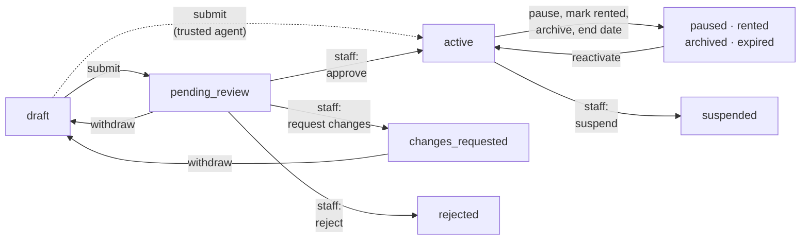

# Listing lifecycle

A listing is always in exactly one state. Only an **active** listing that hasn't passed its end date is shown to tenants. Every change is recorded in the listing's history with a reason, which the lister can see.

## The states

| State | Who sets it | Seen by tenants | Takes enquiries |
| --- | --- | --- | --- |
| `draft` | Lister starts a listing, or withdraws one | No | No |
| `pending_review` | Submit | No | No |
| `changes_requested` | Staff | No | No |
| `rejected` | Staff | No | No |
| `active` | Staff approval, or submit for a trusted agent | **Yes**, until its end date | Yes |
| `paused` | Lister | No | No |
| `rented` | Lister | No | No |
| `expired` | Automatic, at the end date | No | No |
| `archived` | Lister | No | No |
| `suspended` | Staff | No | No |
| `deleted` | Lister (soft delete) | No | No |

Tenants keep access to an enquiry for **90 days** after a listing expires (a setting, used once enquiries are built).

## What the lister can do

| Action | From | What happens |
| --- | --- | --- |
| **Withdraw** | In review, changes requested | Back to draft. A reserved Free listing is released. The open review item is closed. |
| **Pause** | Active | Off the site. An agent's slot is given back. **Every clock keeps running.** |
| **Mark rented** | Active, paused | Off the site. Paid placement is removed; the plan itself keeps running. |
| **Archive** | Active, paused, rented, expired | Off the site for good, keeping its history and enquiries |
| **Reactivate** | Paused, rented, expired, archived | Back to active, or to review if a check calls for it. Needs cover: a running plan, a free agent slot, or the Free listing's own 30 days. Otherwise `PLAN_REQUIRED`. |
| **Delete** | Any | Soft delete: hidden everywhere, kept for records |
| **Confirm availability** | Active, paused | Resets the 7-day check-in clock and refreshes the quality score |

Only drafts can be edited. After **changes requested**, the lister withdraws the listing to a draft, fixes it and submits again. Editing a live listing is not built yet.

:::note[Rule · Reactivating keeps the original dates]
A listing reactivated inside its original duration keeps its original end date. Its first-published date and freshness date never reset, so pausing and reactivating can't make an old listing look new.
:::

## Expiry

- A job runs **every minute** and moves every active listing past its end to `expired`, giving an agent's slot back.
- Search, listing pages and the contact gate also check the end date at read time, so a listing is never shown past its end even if the job is late.
- Free and agent listings get an in-app reminder **3 days** before they end, once per end date.

## PG availability check

PGs change fast, so live PGs are asked to check in:

- Every **7 days** without a confirmation, the lister gets a reminder.
- A PG not confirmed in 7 days shows **"Availability not recently verified"**.
- A tenant's [room alert](../tenants/pg-room-alerts.mdx) lasts 60 days.

## Edge cases worth testing

- Pause a flat, then mark it rented: allowed.
- Archive a listing in review: refused.
- Reactivate an expired Free listing: `PLAN_REQUIRED`.
- A listing whose end date passed one second ago, before the expiry job runs: not shown.
- History after approve, pause, reactivate: three rows with reason codes.
