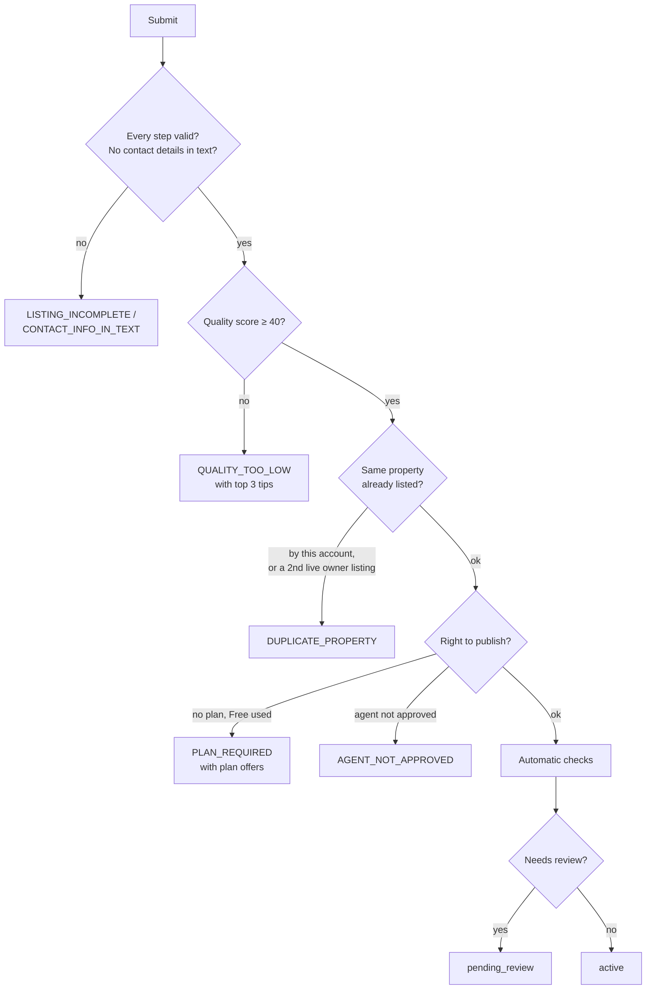

# Submitting a listing

When a lister presses **Submit**, the backend runs a fixed series of checks. A failure stops at the first problem and tells the lister what to fix. If everything passes, the listing either goes **live** straight away or into **staff review**.

:::info[What works today]
Submit works end to end for an **owner using their Free listing**. A listing with a paid plan can't go live yet, because bought plans aren't connected to listings. Agents can't submit at all yet. See [Known limitations](../known-limitations.md).
:::

## The checks, in order

| # | Check | Fails with |
| --- | --- | --- |
| 1 | Every wizard step is complete and valid, including photos | `LISTING_INCOMPLETE` with the list of problems |
| 2 | No phone numbers, emails or links in the text | `CONTACT_INFO_IN_TEXT` |
| 3 | [Quality score](./quality-score.mdx) is at least 40 | `QUALITY_TOO_LOW` with the score and the top 3 tips |
| 4 | The property isn't already listed (see below) | `DUPLICATE_PROPERTY` with the existing listing's code |
| 5 | The lister has the right to publish (see below) | `PLAN_REQUIRED` with the plans on offer, or `AGENT_NOT_APPROVED` |
| 6 | Automatic checks run and raise flags | Never fails; a flag sends the listing to review |
| 7 | Routing: live or review | |

If two submits of one listing race, only one goes through. The draft must not have changed since the checks started.

## Duplicate properties

The backend recognises the same physical flat across listings by its unit number and map pin.

- The **same account** can't list a unit it already lists.
- A unit can have only **one live owner listing**. A second owner trying to list it is refused, and staff get a queue item to look at.
- A close but not exact match (a **possible duplicate**) doesn't block the submit, but sends the listing to review.
- A lister who listed the same unit in the **last 180 days** keeps its original freshness date, so relisting doesn't make an old flat look new.

## The right to publish

| Lister | What gives the right |
| --- | --- |
| Owner (flat or PG) | A paid plan assigned to this listing, or else the owner's [Free listing](./free-listing.mdx). If the Free listing is already used: `PLAN_REQUIRED`. |
| Agent, flat | An approved agent profile with verified identity, the "I'm authorised to advertise this" declaration, and a free slot on the agent's city plan |
| Agent, PG | An approved agent profile and a PG plan assigned to the listing |

## Automatic checks

These never fail the submit. Any hit sends the listing to staff review with the flag attached.

| Flag | Raised when |
| --- | --- |
| Banned words | The text contains "whatsapp", "telegram", "wechat", "advance payment" or "token amount" |
| Duplicate photos | Two of the listing's photos are the same, or a photo matches one another account already uses |
| Rent outlier | The rent is outside the 5th to 95th percentile of comparable live listings (same locality and BHK or sharing, last 90 days; the whole city if fewer than 10) |

## Which listings are reviewed

The first reason that applies is recorded on the review item:

| Reason | Applies to |
| --- | --- |
| `pg` | Every PG listing |
| `first_listing` | Every owner listing today |
| `agent_first_five` | An agent's listings until 5 have been approved |
| `possible_duplicate` | A fuzzy match on the property |
| `auto_flag` | Any automatic check raised a flag |

Anything else goes **live immediately**. In practice today, every listing that can be submitted is reviewed: owners always are, and agents can't submit yet.

A PG whose [KYC](./pg-kyc.mdx) isn't approved yet still goes to review, but carries a **KYC pending** blocker.

## While in review

- The lister can **withdraw** the listing back to a draft. Any Free listing reserved for it is released.
- Media can't change.
- Staff aim to decide within **24 hours** (the target is a setting, not enforced).

What staff can decide is on the [Moderation](../platform/moderation.mdx) page.

## Edge cases worth testing

- Submit with 4 photos: `LISTING_INCOMPLETE` names the media step.
- Submit twice in parallel: one succeeds, one gets an error.
- Owner with the Free listing used, no plan: `PLAN_REQUIRED` lists owner (or PG) plans.
- "Pay token amount on WhatsApp" in the description: goes to review with banned words.
- Withdraw during review, then submit again: the Free listing is reserved again.
