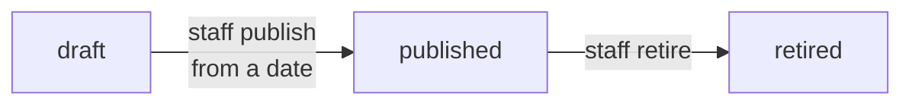

# Plans & pricing

BachelorHouse sells one-time plans through Razorpay. **Nothing auto-renews.** Prices below are the launch catalogue seeded in the backend, in rupees **before 18% GST**. A struck-through "was" price is shown only where the catalogue sets one, always with a recorded reason.

:::caution[Website prices don't match]
The plan pages on the website show different prices for owner and agent plans. The backend catalogue is the one checkout charges. See [Known limitations](../known-limitations.md#website).

| Plan | Website shows | Catalogue charges |
| --- | --- | --- |
| Starter Boost / Prime Connect / Elite Spotlight | ₹499 / ₹799 / ₹1,299 | ₹1,499 / ₹2,499 / ₹3,999 |
| Agent Starter / Plus / Elite | ₹3,999 / ₹4,999 / ₹6,999 | ₹7,999 / ₹10,999 / ₹17,999 |
:::

## Owner plans (one listing)

Bought for one flat. Each one **unlocks all enquiries** on that listing, instead of the Free listing's 2 reveals.

| Plan | Price | Valid for | Matching recommendations | Rank boosts (24 h each) | Badge | Extras |
| --- | --- | --- | --- | --- | --- | --- |
| Starter Boost | ₹1,499 | 30 days | 15 | | | Organic visibility |
| Prime Connect | ₹2,499 | 60 days | 25 | 3 | Featured | Promotion and highlights |
| Elite Spotlight | ₹3,999 | 60 days | 40 | 5 | Premium featured | Priority promotion, one photo and video shoot where serviceable |

## PG plans (one PG)

| Plan | Price | Was | Valid for | Badge | Visibility |
| --- | --- | --- | --- | --- | --- |
| PG Start | ₹1,499 | ₹1,999 | 30 days | | Medium |
| PG Boost | ₹2,899 | ₹3,499 | 60 days | Featured | High, website promotion |
| PG Prime | ₹5,799 | ₹6,499 | 120 days | Premium featured | Highest, website promotion |

All PG plans unlock all enquiries. PG plans are bought by owners and agents.

## Agent plans (one city)

| Plan | Price | Was | Valid for | Slots | Each listing runs |
| --- | --- | --- | --- | --- | --- |
| Agent Starter | ₹7,999 | ₹9,999 | 90 days | 30 | 30 days |
| Agent Plus | ₹10,999 | ₹14,999 | 120 days | 45 | 45 days |
| Agent Elite | ₹17,999 | ₹24,999 | 180 days | 60 | 60 days |

The city is chosen at checkout. See [Agent listings](../agents/agent-listings.mdx) for slots.

## Tenant packages (account)

| Plan | Price | Valid for | Contacts | Extras |
| --- | --- | --- | --- | --- |
| BH Connect | ₹999 | 45 days | 15 | |
| BH Plus | ₹1,499 | 60 days | 30 | Priority enquiries |
| BH Max | ₹2,199 | 90 days | 50 | Priority enquiries |

One package at a time. A new one replaces the current one and unused contacts lapse. Contact counts are only in the plan's feature list for now, not a typed field. Top-up packs are not in the catalogue.

## What a "badge" and "boost" mean

| Benefit | Meaning |
| --- | --- |
| Featured / Premium featured | A tier that raises the listing in results and shows a badge. It only applies while the listing's [quality score](../listing/quality-score.mdx) is 60 or more. |
| Rank boost | A 24-hour lift in results. Used one at a time. |
| Matching recommendation | The listing is recommended to a matching tenant. Matching is switched off for now. |
| Photo and video shoot | BachelorHouse shoots the property, in serviceable areas only |

Ranking, boosts, matching and shoots are not built yet. Their counts are stored with the plan so they can be granted when they are.

## Plan versions

A plan's price and benefits live in a **version**.

- Only a **draft** can be edited. Once published, a version never changes: a change means a new version.
- A plan has at most **one published version** at any moment.
- Publishing a version with a **new price needs a super admin**.
- Every order stores a snapshot of what was bought. Retiring a version doesn't affect anyone who bought it.

## Upgrades and downgrades

- **Upgrade** (a higher tier on the same listing, city or account): the old plan ends now and the new one starts. Unused value of the old plan lapses.
- **Downgrade**: starts when the current plan ends. An agent can only downgrade if their live listings fit the lower slot limit.
- **Same tier again** while it's still running: refused with `PLAN_ALREADY_ACTIVE`. Buying again after it ends counts as a renewal.
- **Tenant packages** are the exception: any new package replaces the running one, whatever the tier.

## Edge cases worth testing

- Plans list for an owner shows only owner plans.
- Publish a draft whose window overlaps the current published version: refused.
- Edit a published version: refused.
- Buy BH Plus while BH Connect has 10 contacts left: those 10 lapse.
